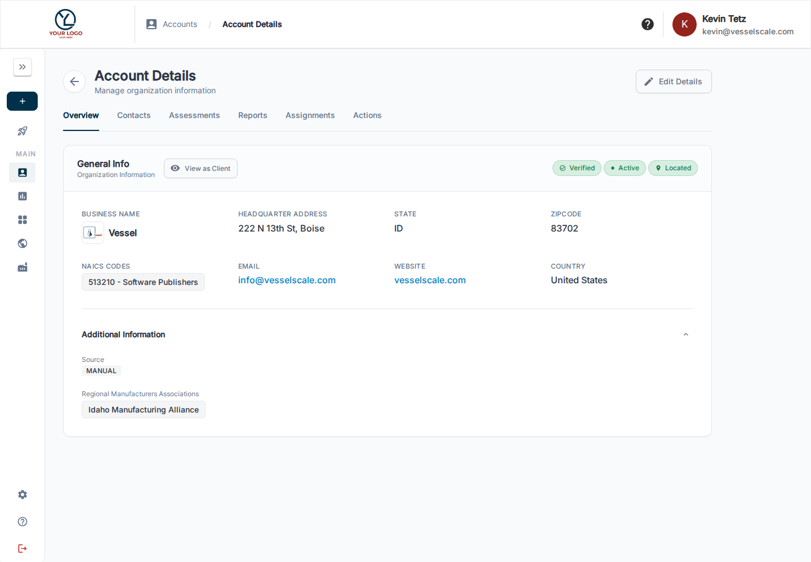
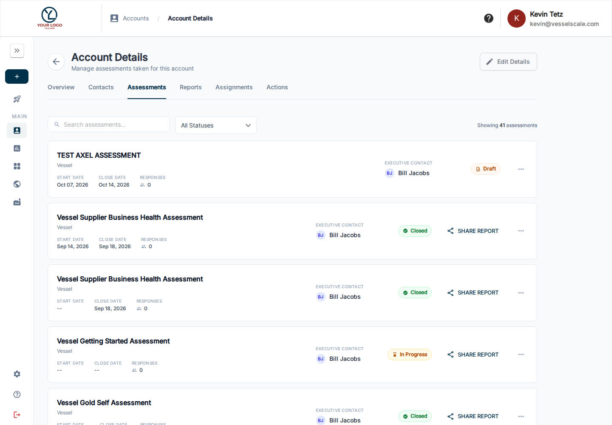
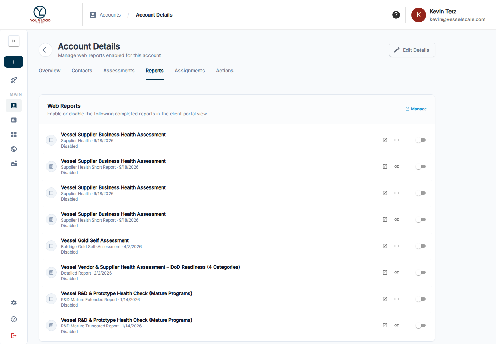

# Account Details

Open **Accounts**, find the organization, and open its details. Use **Edit Details** for its profile. Tabs bring together **Overview**, **Contacts**, **Assessments**, **Reports**, **Assignments**, and **Actions**.

## Overview and contacts

Overview shows the organization’s business name, address, location status, NAICS codes, website, and additional information. Keep its address and industry codes current so maps and comparisons use the right context. Contacts holds the people associated with the organization; account contacts and staff assignments serve different purposes.

## Assessments

Open **Assessments** to find work linked to this organization. Check names, dates, status, responses, and parent/child context, then open an assessment to manage collection or review results. Use **Assign Assessment** to create work for this account.

## Reports and client access

Open **Reports** to manage the completed assessment reports available in the Client Portal. The list pairs each report template with its particular assessment. Use **Manage** and the available enable/disable controls to configure the intended report entries; check each assessment rather than assuming one choice enables every report for the organization.

Administrators maintain reusable templates in **Assessments → Reports**. A template’s active status, assessment type, and client access determine whether the intended report is available. Preview the specific report to verify the account name, assessment dates, content, and branding before sharing it. See [web report settings](../settings/web-reports.md) and [PDF output](../assessments/pdf-reports.md).

## Assignments and actions

Use **Assignments** to maintain the staff responsible for the account. Eligible administrators and account executives can appear in assignment choices. Use **Actions** to follow the recommendations and Plan of Action items associated with its assessments; see [Action Tracker](../impact-tracker/index.md).

## View as Client

Choose **View as Client** from the account overview to enter this account’s portal. The preview banner identifies the account; **Return to Account** returns to staff tools. Check navigation, client-visible templates, and reports from this view.

Preview uses your staff permissions. Assessments a client has hidden with **Hide from account executives & admins** remain hidden from ordinary staff during preview. See [Client Portal staff guide](../client-portal/ae-notes.md).

[Accounts](index.md) · [Edit account](edit.md) · [Assessments](../assessments/details.md)
