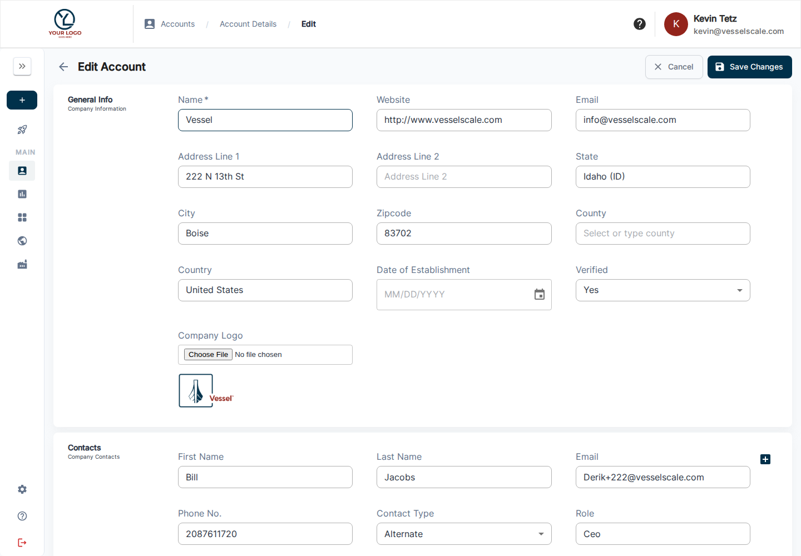

# Edit Account

Use **Account Details → Edit Details** to maintain the organization profile with the permissions available to you. Accurate addresses and NAICS codes support mapped locations, industry filters, dashboard comparisons, and report context.

## What you can do here

- Modify account contact details
- Update industry classifications (NAICS codes)
- Change location information
- Update company name and other organizational details
- Save changes to keep account data current

## Overview

The Edit Account interface provides a comprehensive form to update all aspects of an account's profile. This ensures your account data remains current and accurate as business information changes over time.

## Editing Account Information

Access the Edit Account page by clicking the **Edit Details** button from the Account Details page. The form includes sections for:

- **Basic Information** - Company name, description, and general account details
- **Contact Information** - Primary contact name, email, phone, and address
- **Location** - Geographic information and headquarters location
- **Industry Classification** - NAICS codes and industry codes that classify the business
- **Status** - Account status and operational flags

## Saving Changes

After making updates, click the **Save** button to persist your changes. Validation errors will be displayed if required fields are missing or invalid data is entered.

## Related

- [Account Details](details.md) - View account information
- [Accounts](index.md) - Accounts overview
