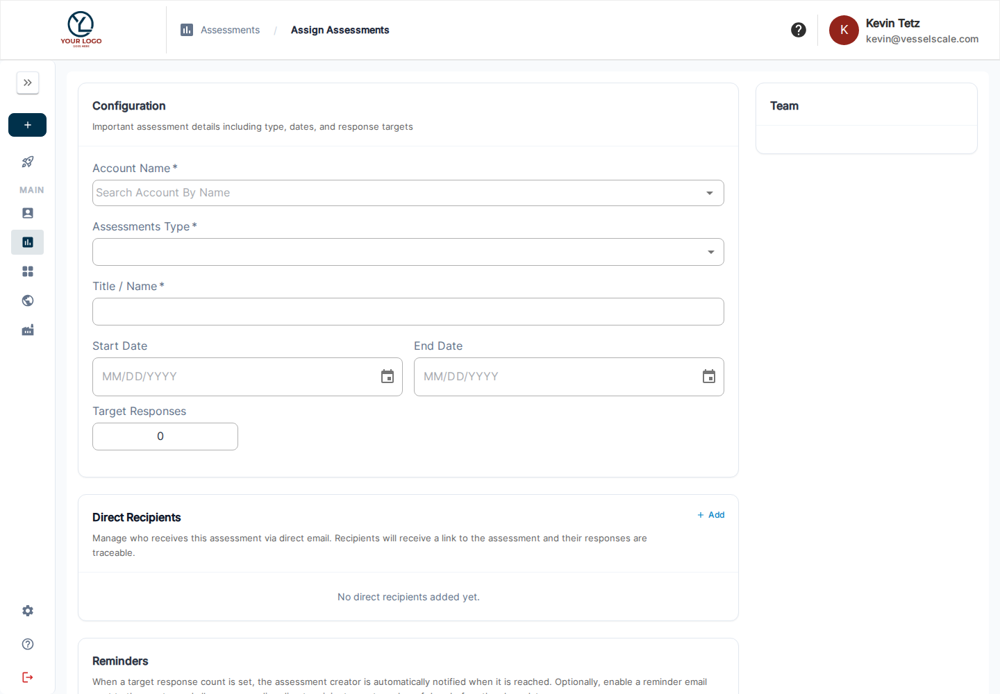

# Assign an Assessment

Choose **Assign Assessment** from Getting Started or the account’s Assessments area. This creates an account-specific assessment from a published Library template.

## Configure the draft

1. Select the **Account** and assessment type. Enter a title that distinguishes the program or reporting period. Review child names if the type creates a group.
2. Set optional **Start Date** and **End Date**. Dates define the response window; they do not start a draft.
3. Review **Target Responses** after adding or removing recipients; the count can change with the recipient list.
4. Add **Direct Recipients** from account contacts or enter their details. Their personalized links support individual progress tracking.
5. Optionally enable **Send Reminder Email** and choose **Days Before Close Date**. The default is 3 days; configure an end date for a scheduled reminder. The creator and direct recipients who have not responded receive the reminder. The creator’s target-reached notification is separate.
6. Where available, review **Allow evidence uploads**. It starts with the assessment type’s default and can be changed for this assessment.
7. Save, then review the assessment details in **Draft** status.

## Start collecting responses

Change the status to **In Progress** when ready, check that any configured response window is open, and share links. Follow [Deliver to respondents](../getting-started/workflow/step-3-deliver.md).

## Client-created assessments

Clients can select a visible template from their Library and choose **Create This Assessment for My Account**. The account and type are prefilled. Clients can choose **Privacy → Hide from account executives & admins** for work they want to keep within their account team. This does not grant template-editing permissions.

[Assignment guide](../getting-started/workflow/step-1-assign.md) · [Assessment details](details.md) · [Client Library](../client-portal/library.md)
