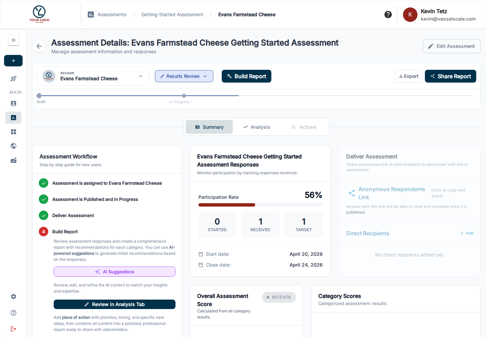
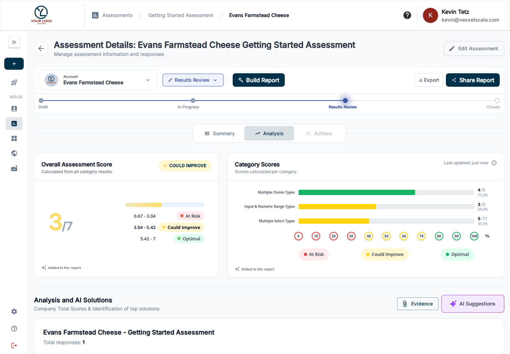

# Assessment Details

Open an assessment from its collection or **Account → Assessments**. The header identifies the account, assessment, dates, and status. Use **Edit Assessment**, **Build Report**, **Export**, and **Share Report** as available.

## Status and collection

| Status | Work to do |
| --- | --- |
| Draft | Review questions, dates, recipients, targets, and response settings. |
| In Progress | Collect responses while the configured date window is open. |
| Results Review | Analyze responses, save findings and recommendations, and prepare the report. |
| Closed | Share available results and manage follow-up actions. |

The **Summary** tab includes the Assessment Workflow guide and participation details. Its detailed status guide includes the publishing/start-collection action; the new Getting Started landing page groups this under **Deliver to respondents**.

Share the **Anonymous Respondents Link** for broad participation, or use **Direct Recipients** for personalized links and tracking. Review received responses against the target and follow up with nonrespondents. Keep personalized resume links intact so the respondent identity is preserved.

## Analysis, responses, and evidence

Open **Analysis** to inspect overall and category scores, low-scoring statements, and available solutions. Review the actual responses behind a score. Where offered, include or exclude an individual response from analysis and reporting; inspect the resulting totals after changing inclusion.

Evidence controls appear when enabled. Preview attachments, including PDFs, alongside the relevant question or response. Respondents can inspect and remove their own draft uploads before submission; reviewing evidence does not require downloading every file.

Use **Build Report** for the assessment-specific findings, category recommendations, and Plan of Action. **Save Notes** for your notes and confirm success before leaving. See [Report Builder](report-builder.md).

## Reports and privacy

Use **Share Report** and the available report controls to select a web report or a stored generated PDF. The reusable report must fit the assessment type and be available for the intended client. Manage client-facing entries in **Account → Reports**, which distinguishes reports for individual assessments.

**Client visibility of a template** controls what appears in the client Library. **Privacy → Hide from account executives & admins** controls a client-created assessment. These are different settings: ordinary staff cannot see a client-private assessment, including through View as Client.

## Close and hand off actions

Before first closure, save the analysis and Plan of Action and review the report with the client. In the close dialog, refine the proposed action items and exclude items that should not carry forward. The accepted recommendations and Plan of Action populate **Recommended Actions**, **Solutions**, **Key Priorities**, and **Implementation Details & Timing**. Your organization may rename the first two lists.

Use **Actions** for ongoing work after that handoff. Reclosing an assessment does not recreate or automatically refresh existing action items. Add or edit items directly, including assessment-level Global Items for priorities and implementation work.

[Getting Started](../getting-started/index.md) · [Scoring](scoring.md) · [Question types](question-types.md) · [Share results](../getting-started/workflow/step-5-provide-results.md) · [Action Tracker](../impact-tracker/index.md)

## Started responses and inclusion in analysis

**Started** tracks respondents who have begun but have not submitted; **Received** tracks submitted responses. A started draft is not a received response. Use these counts with Target Responses to understand collection progress and follow up before closing collection.

Where response-management controls are available:

1. Select the submitted response you want to review.
2. Choose whether to **include or exclude** it from analysis.
3. Recheck response counts and calculated scores after changing inclusion.
4. Review saved findings and regenerate any PDF that needs the updated results.
5. Re-include the response when it should contribute again.

Excluding a response keeps its record while removing its contribution to calculated results and reporting; it does not delete the response.
