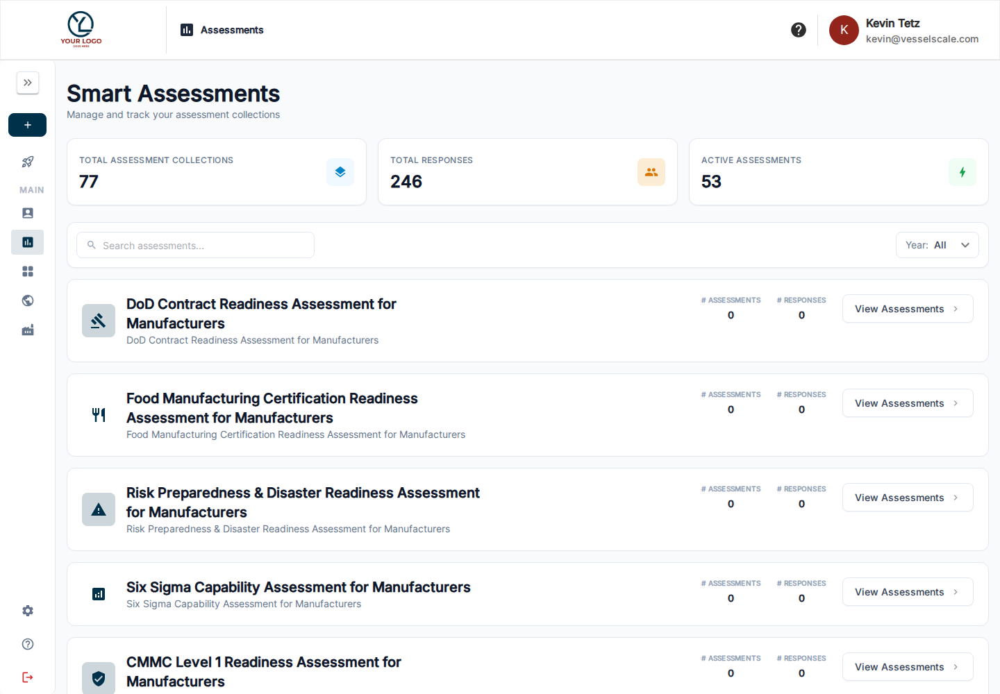

# Assessments

Use **Assessments** to manage assessments assigned to accounts. Collection cards group assessments by type and show assessment and response counts. Search or filter the available collections, then choose **View Assessments** to inspect the work for a type.

## Choose the right tool

| Tool | Purpose |
| --- | --- |
| **Assessments** | Account-specific assessments, recipients, responses, status, analysis, and sharing. |
| **Assessments → Library** | Reusable questions, categories, scoring, and template feedback. |
| **Assessments → Reports** | Reusable report layouts and standard content, managed by administrators. |
| **Account → Assessments** | Find assessments for one organization. |

## Run an assessment

Follow the in-product Getting Started guide: **Assign an assessment → Deliver to respondents → Build your report → Share the results**. Assessments move through **Draft → In Progress → Results Review → Closed**. Parent and child assessments can have distinct response counts and status; review the relevant member of the group before interpreting its results.

Client-private assessments remain hidden from ordinary admin and AE views. Account and response access also follow your permissions.

[Assign an assessment](create.md) · [Assessment details](details.md) · [Getting Started](../getting-started/index.md) · [Library](../library/index.md)
