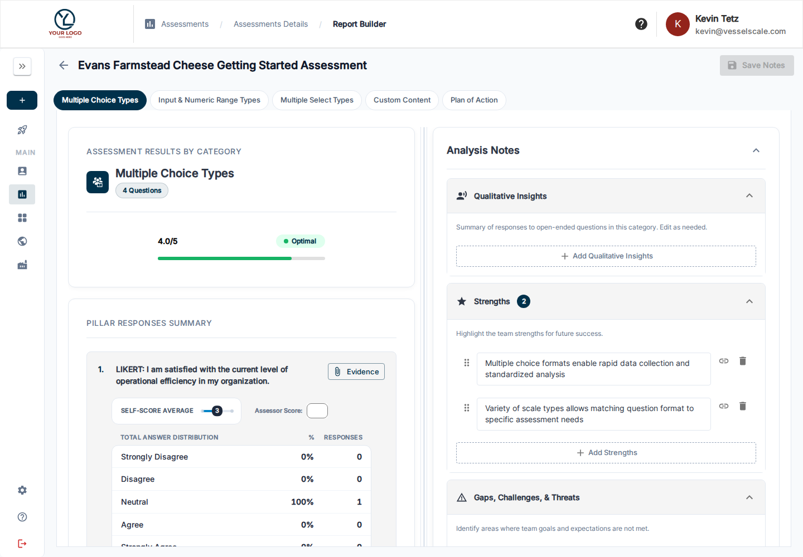

# Report Builder

Report Builder holds the findings and recommendations for **one assessment**. A reusable [web report template](../settings/web-reports.md) defines how that content appears to readers.

## Open and review

Once responses are available, open **Assessment Details → Build Report**. Use **Analysis** to inspect scores and responses, and move to **Results Review** when collection finishes.

Review category results, the responses behind them, and any supporting evidence. Check which responses are included in analysis. Missing scores should be understood as missing data rather than assumed to be zero. Score zones and labels follow the template’s configuration.

## Write findings and recommendations

Work through each category and document the supported strengths, gaps, root causes, qualitative insights, solutions, and recommended actions shown in your organization’s configuration. Distinguish the client’s responses from your interpretation and recommendations.

Where enabled, **AI Suggestions** can draft category findings and a baseline Plan of Action. Review the generated content, remove unsupported statements, and connect the proposed actions to useful services, programs, and resources. Check the contributor and category context before accepting suggestions.

## Save notes explicitly

Use **Save Notes** to persist notes and recommendations, and confirm the success message. Report Builder notes require an explicit save. Save before leaving or previewing the final client report; an in-editor change alone does not confirm it is stored.

## Build a Plan of Action

Capture **Key Priorities** and **Implementation Details & Timing** for the whole assessment. Agree on the work, responsibilities, sequence, and timing with the client. These assessment-level items become Global Items in the Action Tracker at first closure; category recommendations retain category context.

## Preview and share

Preview the assessment with the intended web report template. Its standard introduction, methodology, and organization content combine with this assessment’s scores, saved analysis, and Plan of Action. Confirm the account name and assessment dates.

Configure client report access for the specific assessment, review the proposed actions at first closure, then share the web report. Use browser printing for PDF output by default; AI PDF is a separate option when enabled for that web report.

[Build your report guide](../getting-started/workflow/step-4-build-report.md) · [Share the results](../getting-started/workflow/step-5-provide-results.md) · [PDF reports](pdf-reports.md)
