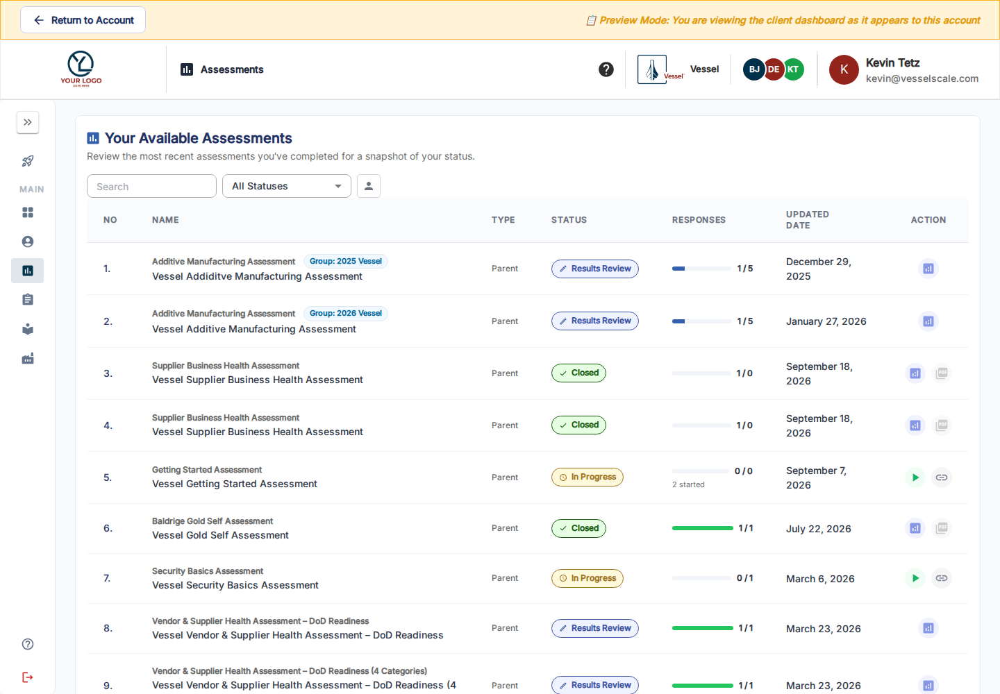

---
tags:
  - client-portal
---

# Your Assessments

Open **Assessments** in the Client Portal to see assessments assigned to your organization and those your account has created. Search by name and filter by status to find the right work.

## Respond or manage

Use **Take Assessment** when available to answer the questionnaire. Follow the questions and submit when complete. Retain the personalized invitation or resume link when returning to an open assessment so your respondent identity stays attached.

For an assessment you created yourself, use **View / Edit** when offered to check its title, dates, privacy, and response options. Use **Copy Link** or the available sharing controls to invite colleagues. Check the response window before inviting people. Contact your account executive to change an assessment they assigned.

## Understand status

| Status | Meaning |
| --- | --- |
| Draft | Preparation; review the available setup controls before inviting respondents. |
| In Progress | Collection is active within any configured start/end dates. |
| Results Review | Responses and recommendations are being reviewed. |
| Closed | Finalized results and reports can be available according to access settings. |

Report and response buttons depend on status, permissions, and configuration. For grouped assessments, inspect child names, status, and response counts to understand which part needs attention.

## Evidence and results

Where enabled, upload supporting evidence for the relevant question. Preview your draft files, including PDFs, and remove incorrect uploads before submitting. After results are released, open the available report and discuss recommendations with your account executive. PDF output uses browser printing unless AI PDF is enabled for that report.

Client-private assessments remain within the account team when **Hide from account executives & admins** is selected; staff preview does not bypass that setting.

[Getting Started](getting-started.md) · [Start from the Library](library.md) · [Portal overview](index.md)
