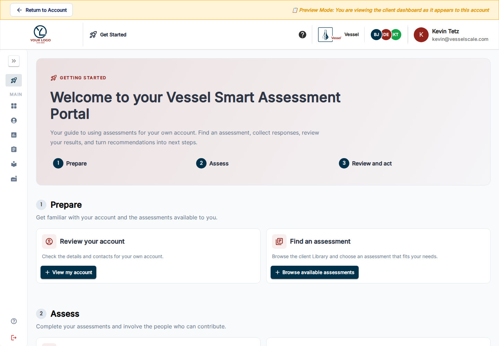

---
tags:
  - client-portal
---

# Getting Started in Your Client Portal

Open **Getting Started** from the portal’s rocket icon. Your landing page focuses on your own organization and uses three phases: **Prepare → Assess → Review and act**.

Select a card to read its guidance, then use the action button to open the relevant page. Your guide and available tools follow your organization’s enabled features.

## 1. Prepare

- **Review your account** — Where Account is enabled, check your organization’s profile and contacts. Use the edit controls available to you. Contact your account executive if your login is linked to the wrong organization.
- **Find an assessment** — Browse the client Library (scroll past **What you have taken** to **Available Assessments** when that history is shown), search by name or description, and filter by group. Your administrator chooses which published types are visible. Select a type and choose **Create This Assessment for My Account** to start your own assessment.

## 2. Assess

- **Assess your organization** — Review your self-created assessment’s dates and response options. Use **View / Edit** where offered, check that collection is open, and invite colleagues with the available link/share controls.
- **Complete your responses** — Open **Assessments**, find the assigned or self-created assessment, and choose **Take Assessment** when available. Answer the questions and submit. Use the original response link to return to work that is still open.

If evidence is enabled, attach supporting files to the relevant questions. Preview your draft uploads and remove any incorrect files before submitting.

## 3. Review and act

- **Review your results** — Open the scores, analysis, recommendations, and reports made available for your account. Ask your account executive about work that is still being reviewed.
- **Explore your dashboard** — Where enabled, inspect your account’s progress and switch assessment types to review comparable results.
- **Follow up on your actions** — Where enabled, review recommendations, priorities, and implementation work; coordinate progress with your account executive.
- **Explore industry context** — Use industry information and available benchmarks to discuss strengths and opportunities.

## Choose privacy for your own assessments

For assessments you create or edit yourself, **Privacy → Hide from account executives & admins** keeps the assessment within your account team. Ordinary staff cannot see it through View as Client. Discuss visibility with your account executive when you want their help reviewing that work.

[Portal overview](index.md) · [Your assessments](assessments-table.md) · [Client Library](library.md) · [Industry context](industry-benchmarking.md)
