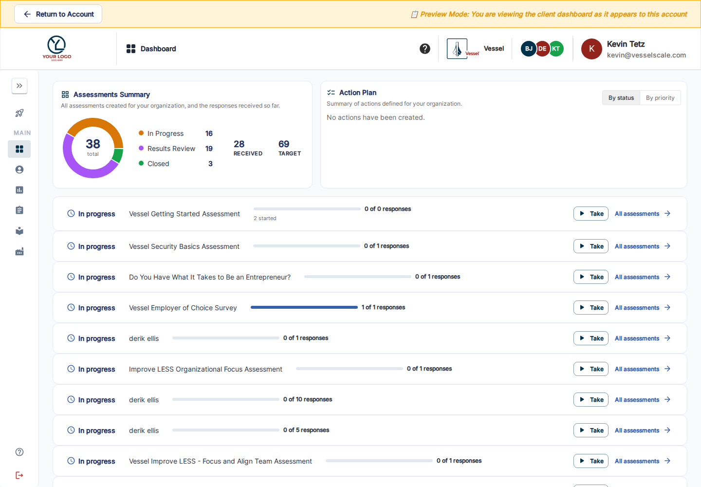
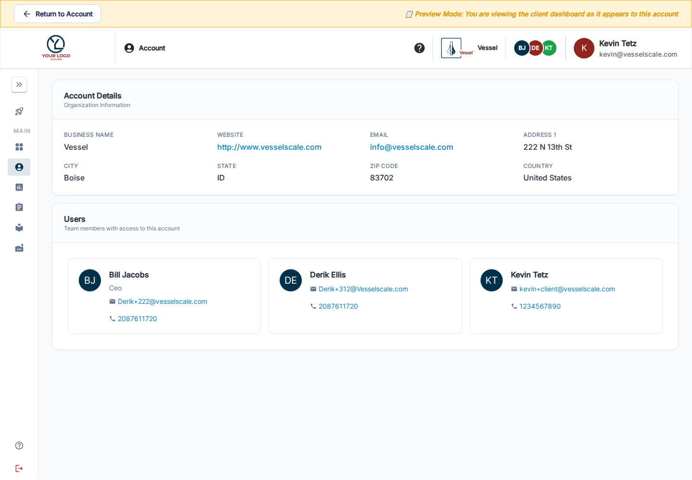

---
tags:
  - client-portal
---

# Client Portal

The Client Portal brings your own organization’s assessments, results, reports, and follow-up work together. Start with **Getting Started** for the role-specific **Prepare → Assess → Review and act** guide.

## Find your next task

| Area | What it is for |
| --- | --- |
| Getting Started | Learn the workflow and open the next workspace. |
| Dashboard, where enabled | See account progress, scores, trends, and available benchmarking. |
| Account, where enabled | Review and maintain your own organization’s details and contacts. |
| Assessments | Find assessments assigned to or created by your account and open available response or report actions. |
| Actions, where enabled | Follow recommendations, solutions, priorities, and implementation work. |
| Library | Browse the assessment types your administrator has made available and start an assessment for your account. |
| Industries | Explore industry classifications and available context. |

Portal layouts depend on enabled features. Some layouts provide Actions and Industries as Dashboard tabs. The Library is a catalog of templates; Assessments contains actual work already created for your account.

## Status and results

**Draft** means the assessment is being prepared. **In Progress** means it is collecting responses within its date window. **Results Review** means findings are being reviewed. **Closed** makes finalized results available according to report access settings. Use the actions shown for your assessment and contact your account executive when an assigned assessment needs changes.

## Account information and actions

Where available, use **Account** to keep your organization’s information current and **Actions** to follow up on agreed work. Each action retains its assessment context. Review progress and priorities with your account executive.

## Staff preview

Staff enter this layout through **Account → Overview → View as Client** and return with **Return to Account**. Preview keeps staff permissions, so client-private assessments stay hidden from ordinary staff. Screenshots with the Preview Mode banner illustrate this staff preview.

[Client Getting Started](getting-started.md) · [Assessments](assessments-table.md) · [Library](library.md) · [Staff guide](ae-notes.md)
