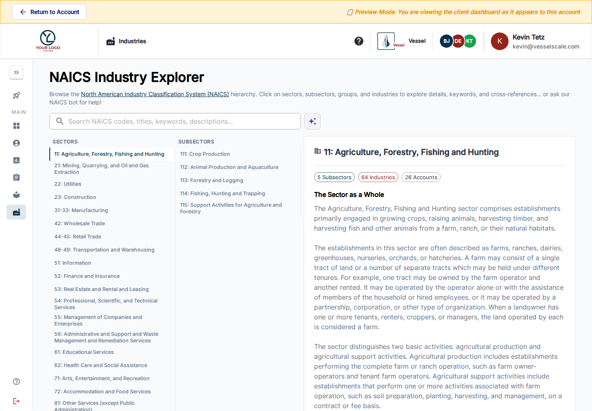

---
tags:
  - client-portal
---

# Industry Context and Benchmarking

Use **Industries** to explore the NAICS classifications available in your portal. Where benchmarking is enabled and data is available, the dashboard and result views let you compare your organization’s scores with relevant industry or peer results.

## Read comparisons in context

Check the assessment type, category, industry grouping, and reporting period before interpreting a comparison. A missing result or insufficient benchmark is not a zero score. Current cohort and dashboard comparisons exclude in-progress assessments from finalized score comparisons.

The newer client dashboard can show peer cohort trends and performance bands grouped by sector. Available charts depend on your organization’s portal configuration and the underlying assessment data. Select assessment-type tabs to compare the right results.

Use benchmarks to identify questions for discussion: where are the strongest results, which categories suggest a gap, and what practical support would help? Review the underlying responses and recommendations with your account executive before prioritizing work.

Clients see their own account’s results and the industry context made available to them; the client industry view does not expose other organizations’ staff account summaries.

[Client dashboard](index.md) · [Your assessments](assessments-table.md) · [NAICS hierarchy](../industries/hierarchy.md)
