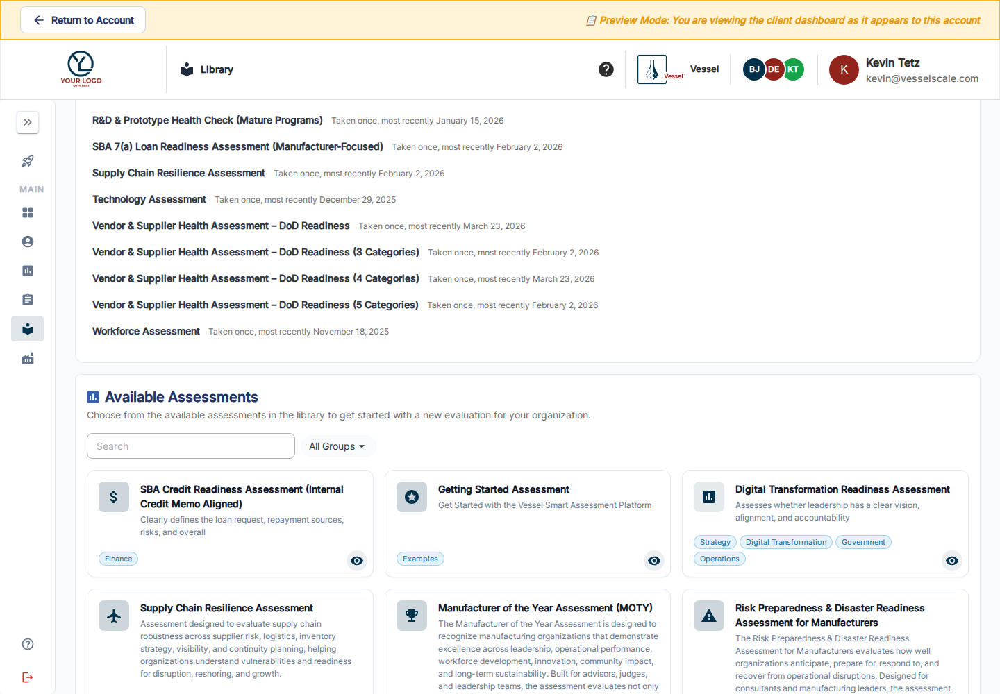

---
tags:
  - client-portal
---

# Client Library

Open **Library** in the Client Portal or choose **Find an assessment** in Getting Started. This catalog contains the published assessment types your administrator has made visible to clients.

## Find a useful template

In the newer portal, **What you have taken** summarizes the types your account has already used, how often, and the most recent date. Scroll to **Available Assessments** below that history to browse the catalog.

Search by name or description and use group filters to narrow the catalog. Open a card to read its description and preview the questionnaire when offered. Ask your account executive if the assessment you need is missing or its questions need to be adapted.

## Start an assessment for your account

Choose **Create This Assessment for My Account** on an available type, review the prefilled account and type, and complete the remaining setup. Save the draft, then find it in **Assessments** to manage dates, response options, and participation.

If you want to keep self-created work within your account team, review **Privacy → Hide from account executives & admins**. You can discuss visibility with your account executive when you want to share the work.

Clients use the supplied templates; they do not design staff Library content. The catalog shows eligible top-level types. Child assessments follow their parent’s workflow.

[Client Getting Started](getting-started.md) · [Your assessments](assessments-table.md) · [Available assessment catalog](all-available-assessments.md)
