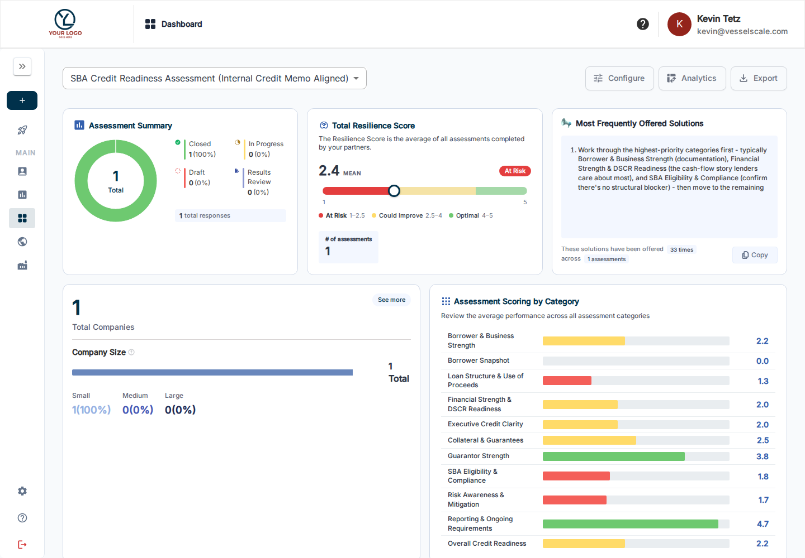

# Dashboard Components

Choose components that answer your team’s questions for the selected assessment type or Directors view. Availability depends on the assessment data and your enabled features.

## Choose charts and components for your questions

The dashboard combines visual charts with tables and summary components. Choose components suited to the selected assessment type and the data you want to explore.

- **Donut charts** — See the assessment status mix and overall counts in Assessments Summary.
- **Score gauges and progress bars** — Review overall resilience scores and highest- or lowest-scoring statements.
- **Horizontal and vertical bar charts** — Compare category scores, average scores by NAICS industry, and numeric or rating responses.
- **Stacked bar charts** — See business-size distribution within NAICS industry groups.
- **Tables and rankings** — Explore top-scoring accounts, frequently offered solutions, in-progress assessments, question response details, and response breakdowns.
- **Individual question components** — Highlight response distributions for selected questions, including binary, multiple-select, rating, and numeric question types.
- **Directors impact chart views** — Switch impact metrics between vertical bar, horizontal bar, line, area, and donut views, and choose the metric and aggregation to explore.

## Read scores and missing data

Score bands and labels follow the assessment’s thresholds and scoring configuration. Current AE score displays use threshold-based bars. Check the selected type, category, response totals, and score range before comparing accounts. A missing score is not a zero result.

The Directors view also includes assessment counts by Account Executive and program-wide activity. Use its impact component’s metric, status, priority, and aggregation controls to determine what is being compared.

[Configure components](configure.md) · [Scoring](../library/scoring.md) · [Export data](download.md)
