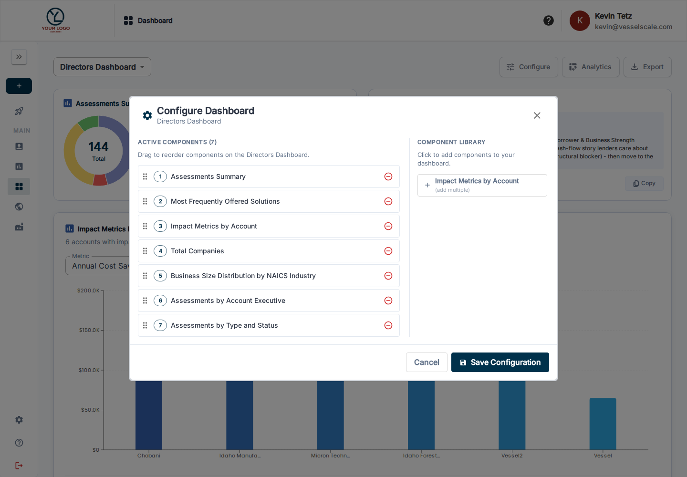

# Configure Dashboard

## Configure the components and layout

Choose a dashboard view, then select Configure to decide which components appear. Add available components, remove ones you do not need, and drag them into the order that works best for your team. In the AE view, you can also add individual question components to highlight particular questions.

Save Configuration to apply the layout. AE dashboard configurations are saved for the selected assessment type, so different types can highlight different questions and measures. The Directors Dashboard has its own configuration for program-wide components.

## Check the saved view

Return to the dashboard and confirm that the intended components and order appear. Choose another assessment type when you need a different comparison; the AE configuration belongs to the selected type. Directors configuration is maintained separately.

[Component reference](components.md) · [Dashboard](index.md)
