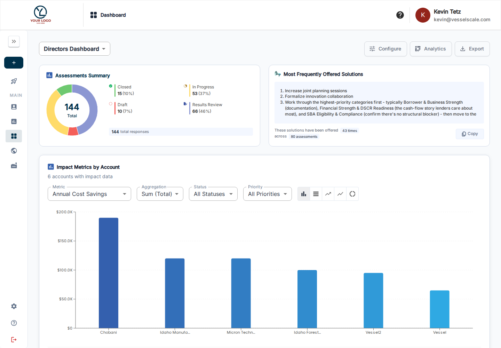

# Directors Dashboard

For users with Directors access, select **Directors Dashboard** from the dashboard dropdown to examine activity across assessment types and accounts.

## Directors Dashboard: across all assessment types

The Directors Dashboard provides higher-level aggregation across assessment types and accounts. For users with Directors access, choose Directors Dashboard in the same dropdown to view the bigger picture of your assessment program.

Its components include assessments by type and status, assessments by Account Executive, overall activity, frequently offered solutions, company and industry composition, and action-tracker impact metrics. Use this view for leadership reporting, program reach, delivery activity, and outcomes; use the AE view for detailed scores within a particular assessment type.

## Configure the components and layout

Choose a dashboard view, then select Configure to decide which components appear. Add available components, remove ones you do not need, and drag them into the order that works best for your team. In the AE view, you can also add individual question components to highlight particular questions.

Save Configuration to apply the layout. AE dashboard configurations are saved for the selected assessment type, so different types can highlight different questions and measures. The Directors Dashboard has its own configuration for program-wide components.

## Aggregate the impact for dashboard analysis

The item-level metrics roll up across accounts and assessments in the Directors Dashboard’s impact component. This connects individual improvement projects to a higher-level picture of the value your program is delivering.

Choose the metric, status, priority, and aggregation you want to analyze. Use Sum for additive totals and Mean or Max for comparisons where appropriate, then explore bar, line, area, or donut views. Use the dashboard’s analytics and export tools to examine the underlying data and prepare program or leadership reporting.

Keep the item records and measurement basis up to date: dashboard totals and comparisons depend on the metrics and filters you have chosen.

## Export and investigate

**Export** offers CSV and YAML for the broader analytics data. Select the appropriate dataset and fields. **Analytics** opens the program-level pivot workspace; use Columns to adjust the selected data and Back to Dashboard to return.

Use program totals for reach, delivery activity, and recorded outcomes. Switch to an individual assessment type for like-for-like category or question comparisons.

[Dashboard](index.md) · [Impact metrics](../impact-tracker/metrics.md) · [Pivot analysis](pivot-table.md)
