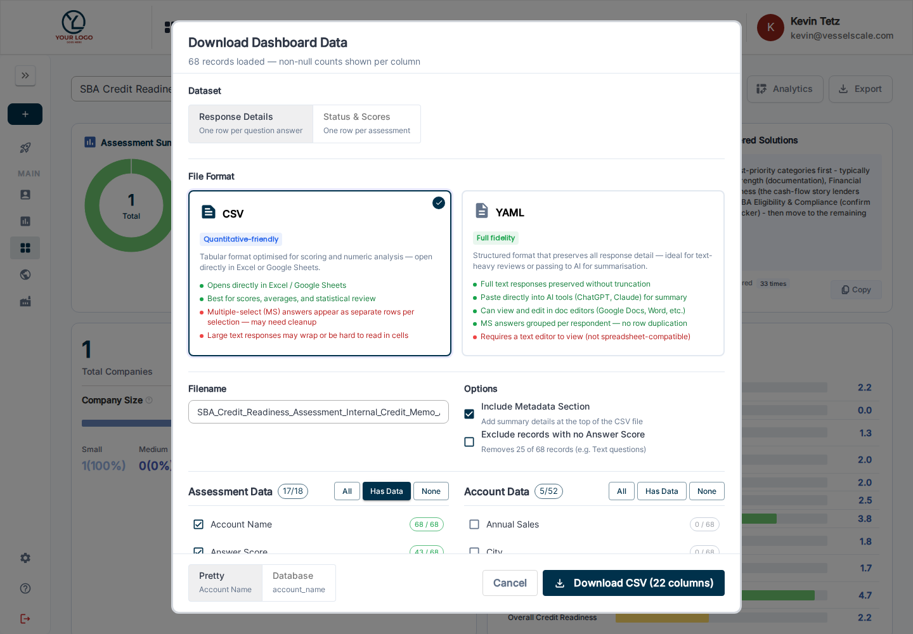

# Export Dashboard Data

Open the dashboard, select the assessment type, then choose **Export**. The AE export produces CSV response data for that type and authorized accounts. Directors export offers CSV and YAML for broader analytics datasets.

## Select data and columns

Review the record count and non-null counts before downloading. Choose assessment fields, account fields, a useful filename, and the options offered in the dialog.

- **Assessment Data** includes names, categories, questions, responses, scores, and relevant parent assessment/year context.
- **Account Data** includes organization characteristics such as location, industry, size, and ownership flags.
- Additional account fields are **opt-in**: choose addresses, contact details, business identifiers, regions, and industry codes when needed.

Use **All**, **Has Data**, or **None** within a field group where offered. Inspect which columns contain data instead of assuming every optional field is populated.

## Format options

**Include Metadata Section** adds context ahead of the CSV data. **Exclude records with no Answer Score** omits unscored records, such as text responses, when selected. Choose readable or database-style column names to fit the tool that will consume the file.

Confirm the selected scope and columns, then use the download action. Dashboard response export and [account import/export](../accounts/import-export.md) serve different purposes.

[Pivot analysis](pivot-table.md) · [Dashboard](index.md) · [Directors Dashboard](directors-dashboard.md)
