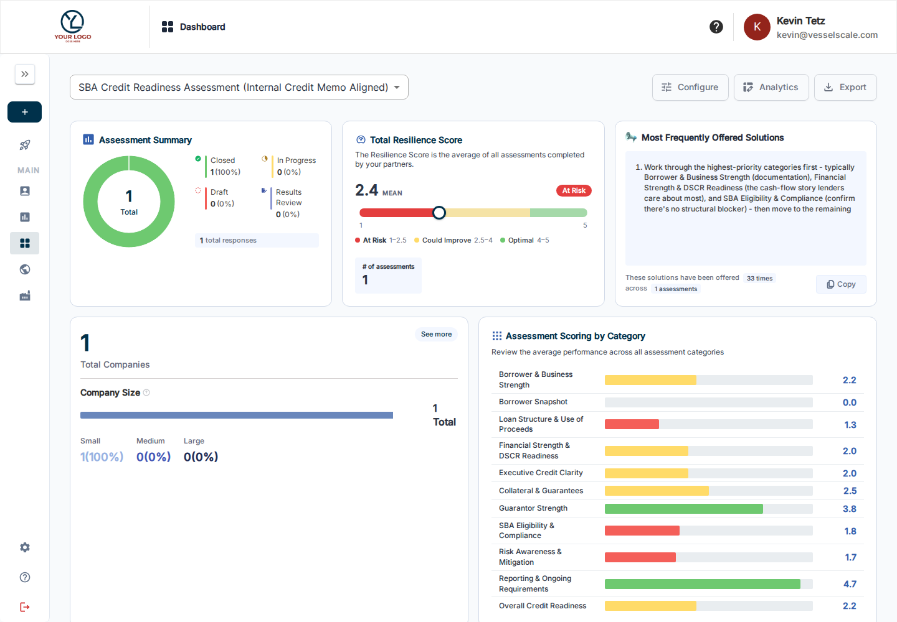

# Dashboard

Configure charts, explore results by assessment type or across your program, and export or pivot the data. Compare scores in the AE view or review broader activity and impact in the Directors Dashboard, where available.

## AE dashboard: one assessment type at a time

The Account Executive (AE) dashboard focuses on the assessment type selected in the dropdown at the top. It brings together the assessments and responses for that type across accounts, so you can compare like-for-like scores, categories, questions, and response progress.

Select a different assessment type to change the data being analyzed. Use this view to understand how accounts are performing on a particular assessment and identify common strengths, gaps, or follow-up needs.

## Directors Dashboard: across all assessment types

The Directors Dashboard provides higher-level aggregation across assessment types and accounts. For users with Directors access, choose Directors Dashboard in the same dropdown to view the bigger picture of your assessment program.

Its components include assessments by type and status, assessments by Account Executive, overall activity, frequently offered solutions, company and industry composition, and action-tracker impact metrics. Use this view for leadership reporting, program reach, delivery activity, and outcomes; use the AE view for detailed scores within a particular assessment type.

## Explore the results

Use **Configure** to choose components and layout, **Export** for a downloadable dataset, and **Analytics** for pivot analysis. Each view reflects its selected assessment type or program scope and your authorized accounts. Finalized score and peer comparisons exclude in-progress assessments.

[Components](components.md) · [Configure](configure.md) · [Export](download.md) · [Pivot tables](pivot-table.md) · [Directors Dashboard](directors-dashboard.md)
