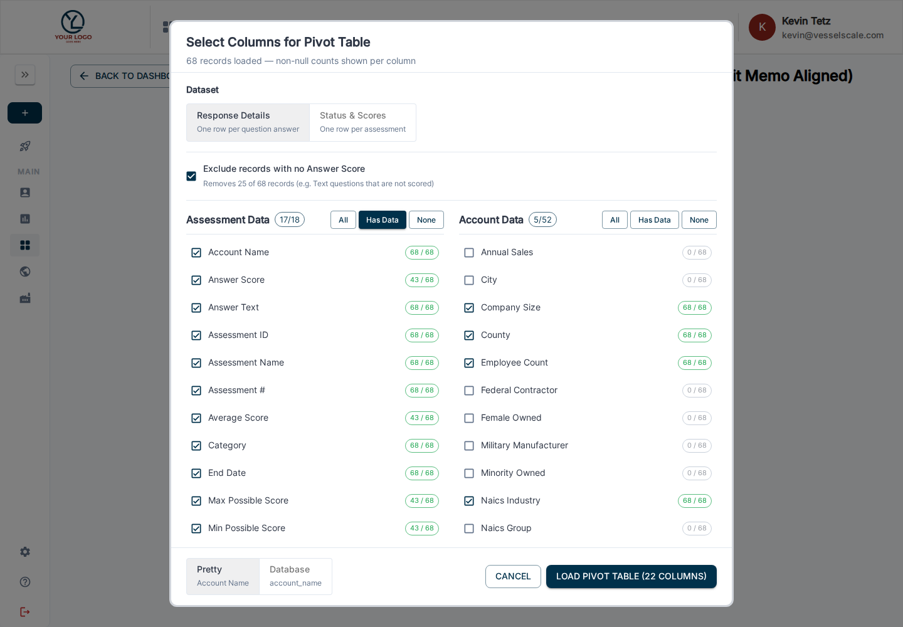

# Pivot Table Analytics

Open **Analytics** from the dashboard. In the AE view, analysis follows the selected assessment type; in Directors, it uses the program dataset available to you.

## Choose fields and load

Select the assessment and account columns needed for your analysis, then load the data. The selector shows non-null counts and quick choices such as **All**, **Has Data**, and **None**. Check the option to exclude records with no Answer Score when you only want scored responses.

Additional account columns are opt-in, including addresses, contact details, business identifiers, regions, and industry codes. Include the appropriate parent assessment and year context when comparing related assessments or reporting periods.

## Explore the workspace

Switch between **Grid**, **Pivot**, and **Chart** views. Sort and filter records, group the data, choose the aggregation that fits your question, and export the current view. Use **Columns** to adjust the fields and **Back to Dashboard** when finished.

Check whether a measure should be summed, averaged, or counted before interpreting it. Keep missing scores distinct from zero values.

[Export data](download.md) · [Dashboard](index.md) · [Directors Dashboard](directors-dashboard.md)
