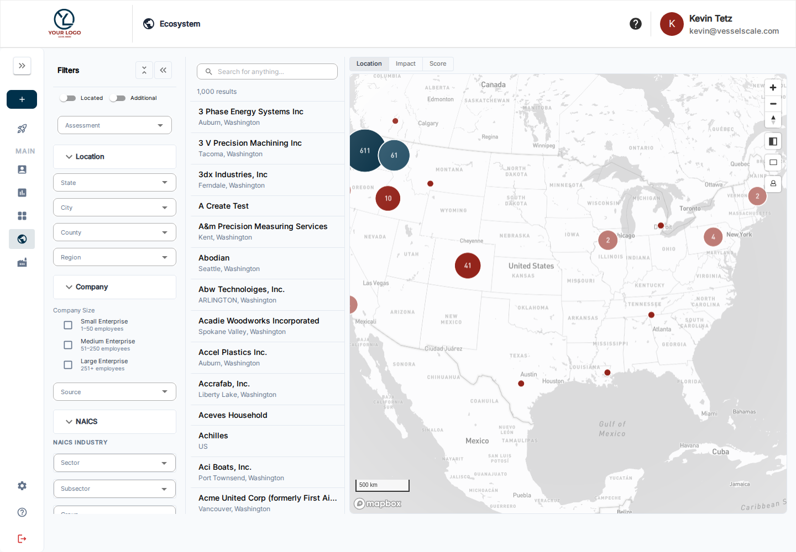

---
tags:
  - ecosystem
---

# Filter the Ecosystem Map

## Filter the map to answer a specific question

Combine filters to focus the account list and map on the organizations you want to understand. For example, explore smaller manufacturers in a region, compare a particular industry’s assessment scores, or inspect impact among selected account characteristics. Use Clear to reset the filters.

- **Assessment and Score Category** — Choose an assessment type, then focus its Score view on the total score or a particular scoring category.
- **Location** — Narrow by State, City, County, Region, or a Zipcode value or prefix.
- **Company Size** — Select the small, medium, or large company-size ranges configured for your organization.
- **NAICS industry** — Work through Sector, Subsector, Group, and Industry to focus on a broad sector or a specific industry.
- **Source and Additional datasets** — Choose a data source, and use Additional to include available datasets beyond your own account records.
- **Account characteristics** — Filter by Partner, OEM Manufacturer, Military Manufacturer, Woman Owned, Veteran Owned, Minority Owned, or Federal Contractor.
- **Located accounts** — Use Located to restrict results to records with a mapped location. Turn it off to include records still needing location information in your account search and list.
- **Account search** — Search the account list to find a specific organization within your current selection.

## Apply and interpret filters

Select the assessment type and view before refining geography, industry, size, or account characteristics. Check the visible legend and counts after changing filters. **Located** filters help distinguish accounts that can appear geographically from those that still need address/geocoding information.

Impact has additional metric, status, priority, and aggregation controls. A filtered map represents the current selection, not every organization in the platform.

[Map overview](index.md) · [Account details](accounts.md) · [Scores](scores.md)
