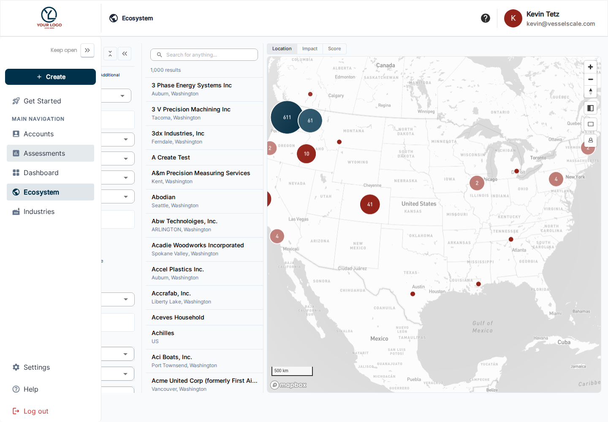

# Ecosystem Map

Put accounts, assessment results, and impact on the map, then explore regional patterns and legislators. Filter by location, industry, or account characteristics, and open an account to investigate its assessments and follow-up work.

## See where accounts are and how they are performing

Use Location to see the geographic spread of your accounts, identify clusters, and find areas where your program could reach more organizations. Zoom in to explore individual locations or use the account list alongside the map.

Select an assessment type and switch to Score to put its results on the map. Choose Total Score or an individual Score Category, then use the legend to compare performance across locations. Switching categories can reveal regional strengths and gaps that an overall score might hide.

## Impact

## Put your impact on the map

Switch to Impact to show the outcomes recorded against action-tracker items geographically. Choose a Metric such as Annual Cost Savings, Annual Revenue Opportunity, Jobs Created / Retained, Employees Impacted, or Annual Hours Saved to see where your work is making a difference.

Use Aggregation to view Sum, Mean, or Max for the selected metric. Narrow the impact data by Status and Priority, and use the labels and legend to understand the values shown for accounts and map clusters. These controls help you explore both the scale and geographic distribution of your program’s recorded impact.

[Filters](filters.md) · [Scores](scores.md) · [Accounts](accounts.md) · [Legislators](legislators.md) · [Impact metrics](../impact-tracker/metrics.md)
