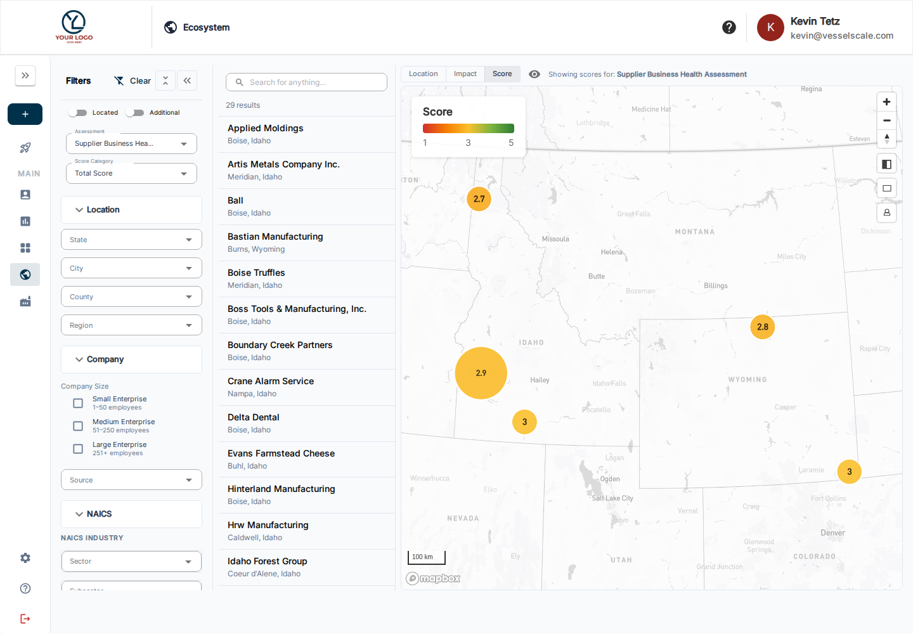

---
tags:
  - ecosystem
---

# Scores on the Map

Select an assessment type in **Ecosystem**, then switch to **Score**. Choose **Total Score** or an individual **Score Category** to compare results geographically.

## Read the selection

Use the legend for the active score scale and bands. Switching categories can reveal strengths or gaps that an overall result hides. Select an account to investigate the assessment behind the displayed result.

Narrow the selection with geography, NAICS industry, size, and other account filters. Compare the same assessment type and category, and check status and available responses before interpreting differences. An absent result is not a zero score.

To map recorded outcomes rather than assessment scores, switch to **Impact** and choose the metric and **Sum**, **Mean**, or **Max** aggregation.

[Map overview](index.md) · [Filters](filters.md) · [Scoring reference](../library/scoring.md) · [Impact metrics](../impact-tracker/metrics.md)
