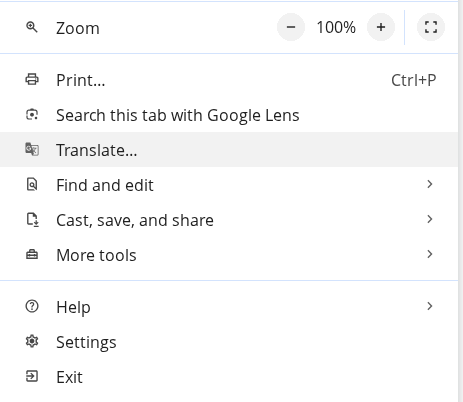
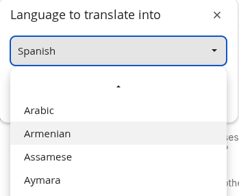
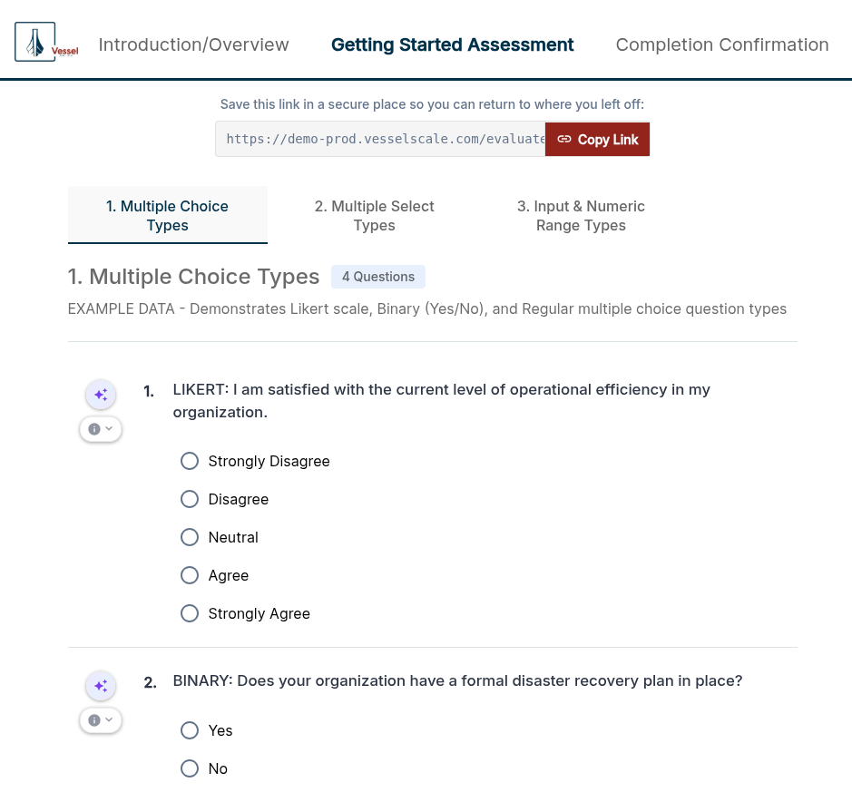
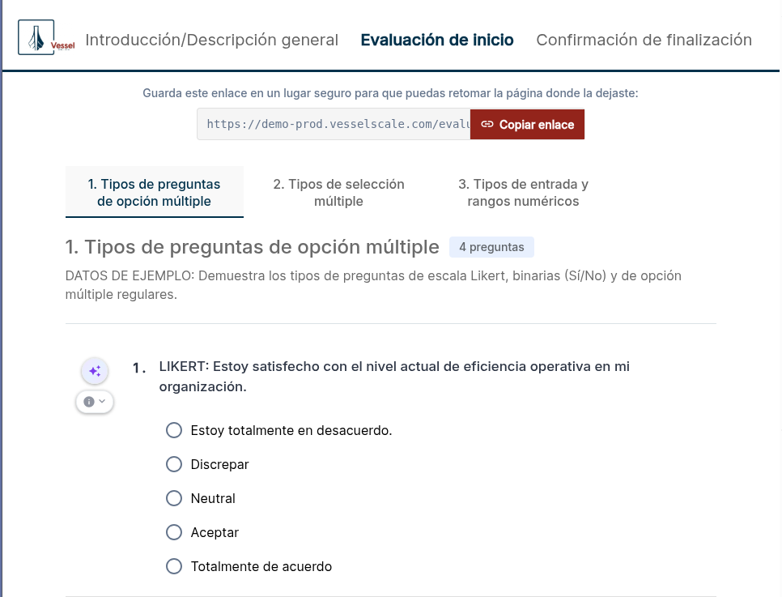

# Frequently Asked Questions (FAQ)

## Can I provide my assessment in another language?

Absolutely! One of the great features of the Vessel Smart Assessment Platform is that assessments can be accessed and completed in virtually any language. Your respondents can view and complete assessments in their preferred language, making it easy to reach a global audience without creating separate assessment copies.

**How to View an Assessment in Another Language**

The easiest way to provide an assessment in another language is to use your browser's built-in translation feature. Here's how to do it with **Google Chrome** (this feature is also available in most other modern browsers like Edge, Firefox, and Safari):

**Step 1: Open the Assessment in Chrome**

1. Navigate to your assessment in the platform using Google Chrome
2. Share the assessment link with your respondent or open it yourself to preview

**Step 2: Access Chrome's Translation Menu**

Chrome automatically detects when a page is in a different language and offers to translate it. You can also manually trigger translation:

1. **Look for the Translate icon** — In the Chrome toolbar (top-right), you may see a Translate icon (looks like a speech bubble)
2. **If not visible**, access it through the **Menu**:
   - Click the **three vertical dots** (⋮) menu button in the top-right corner
   - Look for **Translate** in the menu

**Step 3: Select Your Language**

Once you click Translate, a menu will appear showing the current language and letting you choose the target language:

1. The current language is shown (usually "English" or detected automatically)
2. Click the dropdown to select the language you want
3. Choose from dozens of available languages (Spanish, French, German, Mandarin, Japanese, etc.)

**Step 4: View the Assessment**

The entire assessment will instantly translate to your selected language. The respondent can now:
- Read all questions in their preferred language
- Complete the assessment with instructions in their language
- Submit responses as normal

**Original Assessment (English):**

**Same Assessment Translated (Spanish example):**

**Using Other Browsers**

The translation feature is built into most modern browsers:

- **Google Chrome**: Menu (⋮) → **Translate**
- **Microsoft Edge**: Menu (⋮) → **Translate**
- **Firefox**: Right-click → **Translate Page** (or Menu → **Translate Page**)
- **Safari (Mac)**: Menu → **Translate** (on newer versions)

**Benefits**

This built-in translation feature allows you to:

- ✅ Provide assessments to respondents in their preferred language
- ✅ Eliminate language barriers — no need to manually translate or create duplicate assessments
- ✅ Maintain assessment consistency — all respondents see the same questions and scoring
- ✅ Expand your reach to Spanish-speaking teams, suppliers, and partners

---

## I'm seeing a "404 error" or an error that won't go away even though the feature should be working. What should I do?

This can happen when your browser has cached an outdated response. **The solution is to perform a "hard refresh"** to clear your browser's cache for that page.

**Recommended: Chrome Browser — Shift+Click the Refresh Button**

The easiest method in Google Chrome:

1. Hold **Shift**
2. Click the **Refresh** button (circular arrow icon) in your toolbar
3. Wait for the page to reload

This is the most reliable and user-friendly approach for most users.

---

**Alternative Hard Refresh Methods (All Browsers)**

If the Shift+Click method doesn't work, or you use a different browser, try one of these keyboard shortcuts:

**Windows & Linux**

- **Ctrl + Shift + R** (recommended)
- Ctrl + F5 (alternative)

**Mac**

- **Cmd + Shift + R** (recommended)
- Cmd + Option + R (alternative)

---

**Still Having Issues?**

Save or submit any outstanding work before clearing site data. Clearing site data can remove locally stored draft responses, including offline work.

If a hard refresh doesn't resolve the error:

1. **Clear your entire browser cache:**
   - Open your browser's DevTools (F12 or right-click → Inspect)
   - Go to the **Application** (or **Storage**) tab
   - Click **Clear Storage** or **Clear Site Data**
   - Reload the page

2. **Try an incognito/private window:**
   - Open a new private/incognito window
   - Navigate to the same page
   - If it works here, the issue was definitely your browser cache

3. **Contact support:**
   - If the error persists across browsers and devices, please reach out to the support team with details about what you were trying to do

---

## What is a YAML file and why might I use it?

YAML (*Yet Another Markup Language*) is a plain-text format used for storing structured information in an easy-to-read way. It's commonly used for configuration files because it looks a lot like simple lists and indented outlines — **no programming is required to read or edit it**. This makes YAML ideal for both humans and AI systems to work with.

**Why Use YAML for Importing & Exporting?**

YAML is particularly useful for more complex or structured data that doesn't fit neatly into a simple CSV table format. While CSV works great for flat, tabular data with a fixed number of columns, YAML can represent nested structures, lists, and complex relationships — exactly what you need for detailed account and assessment configurations.

**Key benefits of YAML:**

- ✅ **Human-readable** — Easy to read and edit in any plain text editor (Notepad, VS Code, etc.)
- ✅ **AI-friendly** — AI agents can readily help you convert YAML files to other formats or edit them
- ✅ **Supports complex structures** — Handles nested data, lists, and relationships that CSV cannot represent
- ✅ **Version-control friendly** — Plain text format works well with Git and version control systems
- ✅ **Flexible** — Edit in a text editor or import/export through the platform UI

**Learning More About YAML**

If you'd like to learn more, these resources are helpful:

- [Official YAML site](https://yaml.org/) — Complete specification and reference
- [Quick written intro — Learn X in Y Minutes](https://learnxinyminutes.com/docs/yaml/) — Short, easy-to-scan introduction
- [Beginner-friendly guide — TutorialsPoint](https://www.tutorialspoint.com/yaml/index.htm) — More examples and explanations
- [YAML tutorials on YouTube](https://www.youtube.com/results?search_query=YAML+tutorial+for+beginners) — Video-based learning

**Using AI to Work with YAML**

One of YAML's biggest advantages is that AI assistants can easily help you with it. You can:
- Ask an AI agent to convert a YAML file to CSV format (or vice versa)
- Have AI help you edit or structure your YAML data
- Use AI to validate your YAML syntax and fix errors

Simply copy your YAML content into an AI chat or ask for help converting between formats — AI systems handle YAML very naturally.

**Editing YAML in Built-in Text Editors**

If your YAML file doesn't open automatically in the platform or you want to edit it before importing, you can use your operating system's built-in text editor.

**Windows — Notepad**

1. **Open the file:**
   - Right-click the `.yaml` or `.yml` file
   - Select **Open with** → **Notepad** (or just **Notepad**)
   - If Notepad doesn't appear, click **More apps** and look for it

2. **Edit and copy:**
   - Make your changes in Notepad
   - Select all text: **Ctrl + A**
   - Copy to clipboard: **Ctrl + C**

3. **Paste into other apps:**
   - **MS Word:** Open Word, place cursor where you want text, press **Ctrl + V**
   - **Google Sheets:** Click a cell, paste with **Ctrl + V** (each line becomes a new row)
   - **Google Docs:** Click where you want text, paste with **Ctrl + V**

4. **Save changes (if needed):**
   - Press **Ctrl + S** to save
   - When saving as YAML, ensure the filename ends in `.yaml` or `.yml`

**Mac/OSX — TextEdit**

1. **Open the file:**
   - Right-click the `.yaml` or `.yml` file
   - Select **Open With** → **TextEdit**
   - If it opens in a formatted view, go to **Format** menu and select **Make Plain Text**

2. **Edit and copy:**
   - Make your changes in TextEdit
   - Select all text: **Cmd + A**
   - Copy to clipboard: **Cmd + C**

3. **Paste into other apps:**
   - **MS Word:** Open Word, place cursor where you want text, press **Cmd + V**
   - **Google Sheets:** Click a cell, paste with **Cmd + V** (each line becomes a new row)
   - **Google Docs:** Click where you want text, paste with **Cmd + V**

4. **Save changes (if needed):**
   - Press **Cmd + S** to save
   - When saving, choose **Plain Text** format (not Rich Text)
   - Ensure the filename ends in `.yaml` or `.yml`

**Pro Tip: Copy/Paste Workflow**

If you're moving YAML between applications:
1. Open file in text editor (Notepad or TextEdit)
2. Select all and copy
3. Paste into the destination app (Word, Sheets, Docs, or the platform)
4. For importing back into the platform, copy from the destination and paste into the import dialog

---

## When I click a Sidebar tab, why does it take me to a different page than before?

This is by design! The system remembers where you were last working in each section. When you click on a Sidebar tab (like **Accounts**, **Assessments**, **Dashboard**, etc.), it takes you back to the **specific page and filters you were viewing** the last time you were in that section. This helps you quickly resume your work without having to navigate back to where you were.

**Here's how to navigate effectively:**

1. **Single-click** a sidebar section to resume its remembered page and filters.
2. **Double-click** the section to return to its root/list page. Save pending edits before navigating away.
3. Use **Breadcrumbs** to open a parent location directly.
4. Use the **Back** arrow to return through your browsing history; it does not necessarily open the parent section.

**Note**: The system uses browser session storage to remember your navigation state, so this preference resets when you close your browser window.

---

## How do I create a new Account?

For detailed instructions on creating an Account, please see the [Create Account](accounts/create.md) guide in the Accounts section.

---

## How do I create a new Assessment?

See the [Create Assessment](assessments/create.md) guide for step-by-step instructions on creating an assessment for your respondents.

---

## How do I send an Assessment to respondents?

Visit the [Send to Respondents](getting-started/workflow/step-3-deliver.md) guide in Getting Started to learn how to distribute assessments.

---

## How do I view and analyze Assessment results?

The [Analyze Results](getting-started/workflow/step-4-build-report.md) guide walks you through viewing respondent scores and data.

---

## How do I create a Web Report?

For instructions on creating an interactive web report from assessment data, see [Create a Web Report](settings/web-reports.md).

---

## How do I download assessment data as CSV?

See the [Download CSV](dashboard/download.md) guide for instructions on exporting your assessment data.

---

## How do I use the Pivot Table for data analysis?

The [Pivot Table](dashboard/pivot-table.md) guide explains how to create custom pivot tables to analyze your assessment data.

---

## How do I edit my Account details?

Visit the [Edit Account](accounts/edit.md) page to learn how to update your account information.

---

## How do I design a custom Assessment Definition?

The [Design an Assessment](getting-started/before-you-begin/design-assessment.md) guide in Getting Started covers creating your custom assessment structure.

---

## How do I set up Email Templates?

See the [Email Templates](settings/email-templates.md) guide under Settings to customize your outgoing emails.

---

## How do I customize Branding?

Visit [Branding Settings](settings/branding.md) to learn how to customize your organization's logo, colors, and branding.

---

## How do I manage User Permissions?

The [Permissions](settings/permissions.md) guide under Settings explains how to control user roles and access levels.

---

## How do I create an Assessment Definition in the Library?

See [Create Assessment](library/create.md) in the Library section for instructions on building reusable assessment templates.

---

## Where should a new user start?

1. Open **Getting Started** using the rocket icon.

2. Staff follow **Prepare → Deliver → Analyze**; clients follow **Prepare → Assess → Review and act**.

3. Select a card for guidance and use its action button to continue.

4. See [staff Getting Started](getting-started/index.md) or [client Getting Started](client-portal/getting-started.md).

## Where did Library, Reports, and Intake Forms move?

Use **Assessments → Library**, **Assessments → Reports**, and **Accounts → Intake Forms**. Labels and available tools follow your role and organization configuration.

## Does publishing a template start collection?

1. No.

2. Publish the reusable Library template, assign an assessment to an account, then change the assigned assessment from **Draft** to **In Progress**.

3. Check its date window before sharing links.

4. See [delivery](getting-started/workflow/step-3-deliver.md).

## How do I add an organization or let it register itself?

1. Use **Accounts → Add Account** or share an intake form.

2. Intake forms can collect account details only or create an assessment and redirect into it when configured.

3. See [account setup](getting-started/before-you-begin/add-account.md) and [intake forms](settings/intake-forms.md).

## Can clients create assessments and keep them private?

1. Clients can select a visible type from their Library and choose **Create This Assessment for My Account**. **Privacy → Hide from account executives & admins** keeps self-created work within the account team.

2. Ordinary staff cannot see it through View as Client.

3. See [client Library](client-portal/library.md).

## Why can’t a respondent open an assessment?

1. Check the status, start/end dates, and the link being used.

2. Collection must be open.

3. Preserve personalized response/resume links so the correct respondent identity stays attached.

4. See [assessment details](assessments/details.md).

## Where do I save report findings?

1. Open the assessment and choose **Build Report**.
2. Review each category and write your findings, recommendations, and Plan of Action.
3. Select **Save Notes** and confirm success before leaving.

Notes require an explicit save. Edit the reusable report design separately under **Assessments → Reports**. See [Report Builder](assessments/report-builder.md).

## How do I share or download a report?

1. Open **Account → Reports** and confirm access for the intended assessment and report.
2. Open the assessment’s report controls or **Share Report** and select the report to share.
3. For a browser-produced PDF, use **Print → Save as PDF** and inspect the print preview.
4. If AI PDF is enabled for that web report, request generation and review the generated PDF before sharing it.

See [Web Reports](settings/web-reports.md) and [PDF output](assessments/pdf-reports.md).

## What happens to actions when an assessment closes?

1. At first closure, review, edit, and exclude the proposed items.

2. Accepted category recommendations and Plan of Action items populate the tracker’s four lists.

3. Manage them directly afterward; reclosing does not regenerate them.

4. See [Action Tracker](impact-tracker/index.md).

## Why are evidence or conditional controls missing?

Evidence availability follows enabled features and assessment settings. Conditional authoring is optional: enable it in the Library editor when you need follow-up rules and test the response paths in Preview. See [editor settings](library/edit.md#assessment-settings).

## Why is there no score or benchmark?

Check status, included responses, assessment type, and available comparison data. A missing score is not zero. In-progress assessments are excluded from finalized dashboard/cohort comparisons. See [scoring](assessments/scoring.md) and [benchmarking](client-portal/industry-benchmarking.md).

## How do I export data or use a pivot?

1. Select the assessment type in Dashboard, then use **Export** or **Analytics**.

2. Choose additional account columns explicitly when needed.

3. See [exports](dashboard/download.md) and [pivot analysis](dashboard/pivot-table.md).

## Can I use browser translation?

Your browser’s translation controls can help read a questionnaire in another language. Check translated questions and response choices carefully, especially technical terms. Contact your assessment owner when wording is unclear. Browser translation does not change the saved template’s authored language.

## What is YAML used for?

YAML is a structured text format used for template and data import/export. Use a current platform export as a starting point, keep the expected structure, and resolve validation messages before saving imported configuration.

## A page or action is missing or reports an error. What should I check?

1. Refresh the page, confirm your account and role, and check that the assessment’s status and dates permit the action.

2. Use current sidebar navigation to revisit the workspace.

3. If the problem persists, contact [support@vesselscale.com](mailto:support@vesselscale.com) with the page, action, and error message.

4. Avoid including credentials in a support screenshot.

[Settings](settings/index.md) · [Profile](settings/user-profile.md) · [Permissions](settings/permissions.md)

## Can an account represent an individual or a general survey?

Yes. Choose the account structure before assigning assessments:

1. **For an individual**, create a separate account when you need to keep that person’s assessments and results together.
2. **For a general survey**, such as nominations, use a clearly named shared account when responses should be grouped together.
3. To let respondents enter their information, configure an **intake form** to collect contact information and create the account. Optionally configure it to create an assessment too.
4. Review the account naming, contact fields, and assessment settings before sharing the intake link.

See [Add an account](getting-started/before-you-begin/add-account.md) and [Intake Forms](settings/intake-forms.md).

## Can I answer an assessment without an internet connection?

First, test the complete flow with a non-production assessment on the browser and device you intend to use.

1. **While connected**, create or obtain the assessment link and open it.
2. Select **Continue** to load the questionnaire before disconnecting.
3. **Save or bookmark the exact response link.**
4. Disconnect Wi-Fi or your network connection to test offline use, then answer the questions in the already loaded questionnaire.
5. Keep the **same browser and device**, leave the questionnaire open, and **do not clear browser/site data**.
6. Reconnect to the internet before submitting.
7. Select **Submit** and confirm that submission succeeds.

!!! note "Draft storage is not submission"
    Local browser storage can preserve draft work, but it is not a submitted response and does not guarantee that a closed page will reopen offline. The full offline scenario has not been verified in this documentation refresh. Contact your assessment owner if the test fails.

## Why does a sidebar single click return me to the last page?

1. **Save pending edits** before navigating away.
2. **Single-click** the sidebar section to restore its last visited page, including an editor.
3. **Double-click** the section to return to its root/list page instead.
