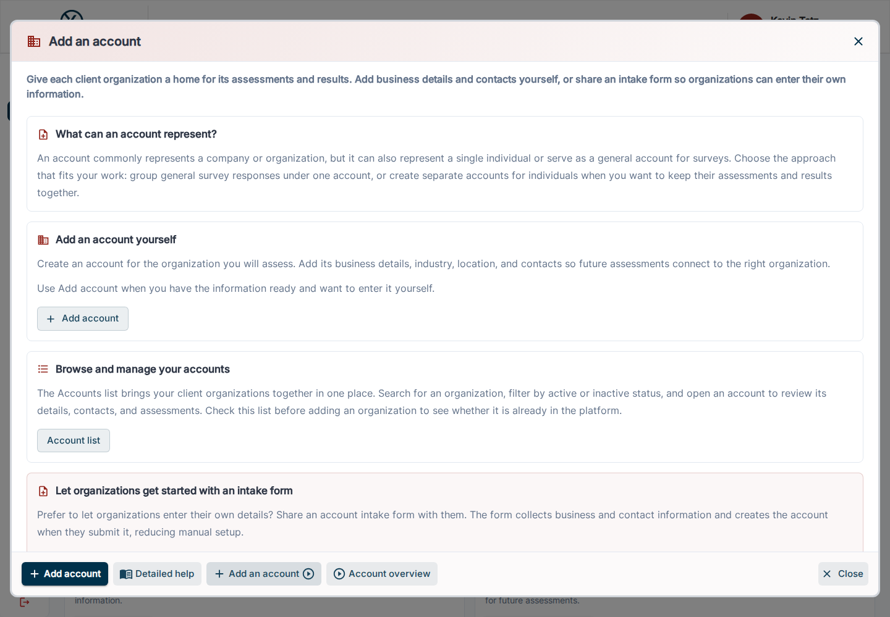

---
tags:
  - getting-started
---

# Add an account

Give each client organization a home for its assessments and results. Add business details and contacts yourself, or share an intake form so organizations can enter their own information.

Open **Getting Started** in the application and select this card to read its guide. Use the action button to continue to the relevant workspace. Available actions depend on your role and enabled features.

## What can an account represent?

An account commonly represents a company or organization, but it can also represent a single individual or serve as a general account for surveys. Choose the approach that fits your work: group general survey responses under one account, or create separate accounts for individuals when you want to keep their assessments and results together.

## Add an account yourself

Create an account for the organization you will assess. Add its business details, industry, location, and contacts so future assessments connect to the right organization.

Use Add account when you have the information ready and want to enter it yourself.

## Browse and manage your accounts

The Accounts list brings your client organizations together in one place. Search for an organization, filter by active or inactive status, and open an account to review its details, contacts, and assessments. Check this list before adding an organization to see whether it is already in the platform.

## Let organizations get started with an intake form

Prefer to let organizations enter their own details? Share an account intake form with them. The form collects business and contact information and creates the account when they submit it, reducing manual setup.

Intake forms can collect account details only, or optionally create an assessment and redirect the respondent straight into it. Enable Create Assessment and select the assessment template in the form configuration to connect account onboarding with assessment delivery.

Share an existing intake form to copy its public link, or create a new form to customize the questions, branding, and assessment options.

## Continue

[Design an assessment](design-assessment.md) · [Account reference](../../accounts/index.md) · [Intake forms](../../settings/intake-forms.md)
