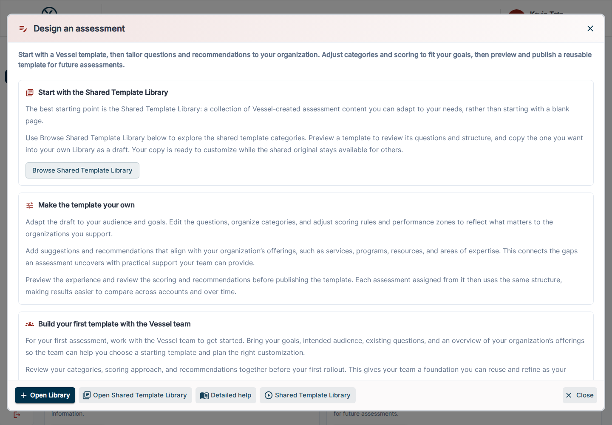

---
tags:
  - getting-started
---

# Design an assessment

Start with a Vessel template, then tailor questions and recommendations to your organization. Adjust categories and scoring to fit your goals, then preview and publish a reusable template for future assessments.

Open **Getting Started** in the application and select this card to read its guide. Use the action button to continue to the relevant workspace. Available actions depend on your role and enabled features.

## Start with the Shared Template Library

The best starting point is the Shared Template Library: a collection of Vessel-created assessment content you can adapt to your needs, rather than starting with a blank page.

Use Browse Shared Template Library below to explore the shared template categories. Preview a template to review its questions and structure, and copy the one you want into your own Library as a draft. Your copy is ready to customize while the shared original stays available for others.

## Make the template your own

Adapt the draft to your audience and goals. Edit the questions, organize categories, and adjust scoring rules and performance zones to reflect what matters to the organizations you support.

Add suggestions and recommendations that align with your organization’s offerings, such as services, programs, resources, and areas of expertise. This connects the gaps an assessment uncovers with practical support your team can provide.

Preview the experience and review the scoring and recommendations before publishing the template. Each assessment assigned from it then uses the same structure, making results easier to compare across accounts and over time.

## Build your first template with the Vessel team

For your first assessment, work with the Vessel team to get started. Bring your goals, intended audience, existing questions, and an overview of your organization’s offerings so the team can help you choose a starting template and plan the right customization.

Review your categories, scoring approach, and recommendations together before your first rollout. This gives your team a foundation you can reuse and refine as your program grows.

## Get a head start with the AI assistant

Where enabled, use AI Creator in the template editor to help draft or refine assessment content. Describe your goals, audience, and the changes you want, including the services and resources your recommendations should point toward.

Use the assistant alongside your own expertise and support from the Vessel team. Review the proposed questions, scoring, and suggestions, then preview and test the template before publishing it for client use.

## Continue

[Assign an assessment](../workflow/step-1-assign.md) · [Library editor](../../library/edit.md) · [Scoring](../../library/scoring.md)
