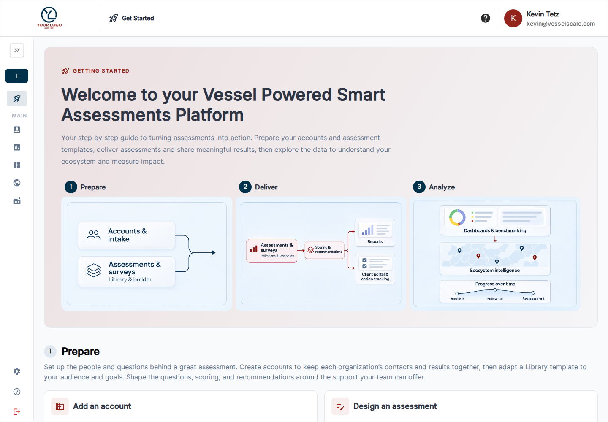
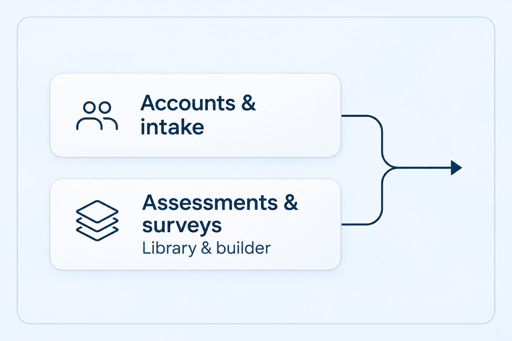
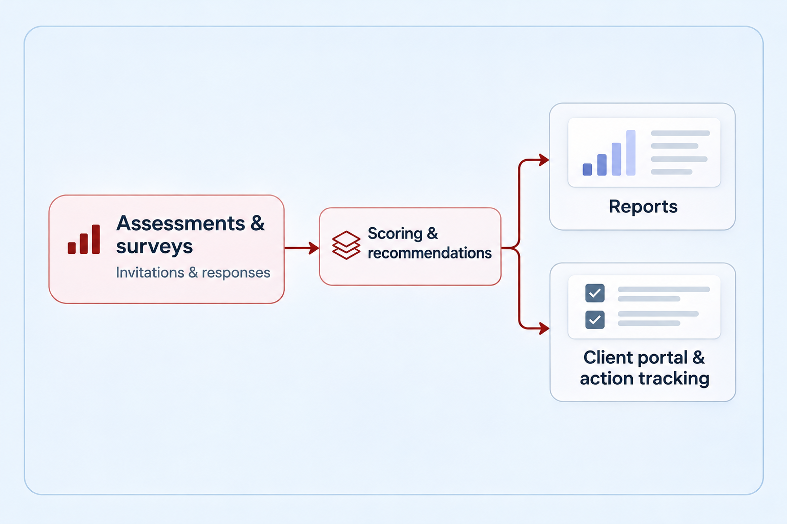
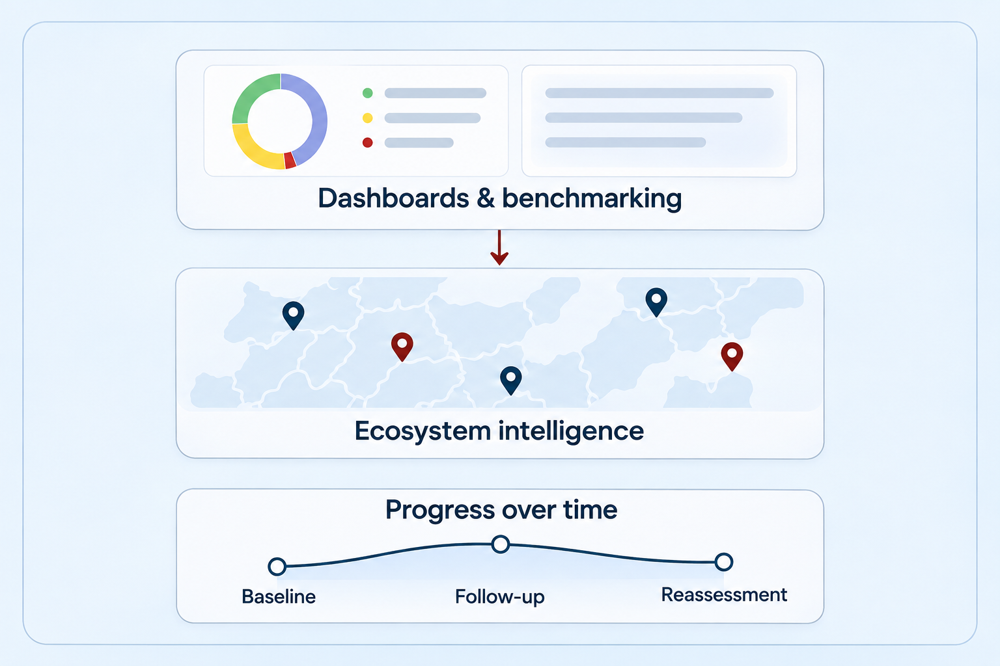

# Getting Started

The **Getting Started** landing page in the application guides you from account setup to client results and measurable outcomes. Open it from the rocket icon in the sidebar. Staff see **Prepare → Deliver → Analyze**; clients see a guide for their own account.

## Prepare → Deliver → Analyze

These are the same three illustrations used by the product’s Getting Started landing page.

- **1. Prepare**

    

- **2. Deliver**

    

- **3. Analyze**

    

## Use the landing page

Select a phase in the illustrated header to jump to its cards. Select a card to open a detailed guide, then use its action button to continue in the application. Tutorial buttons open the related videos. **Where to find** guidance helps locate the next action. The header help button opens relevant workflow guidance where a matching guide is available.

The guides and actions reflect your role, enabled features, and organization’s terminology. Some actions ask you to choose an account or assessment first.

## 1. Prepare

| Card | What you do |
| --- | --- |
| [Add an account](before-you-begin/add-account.md) | Keep an organization’s contacts and results together; enter its information or share an intake form. |
| [Design an assessment](before-you-begin/design-assessment.md) | Browse the Shared Template Library, copy a starting template, tailor questions, scoring, and recommendations, then publish your reusable template. |

For your first template, work with the Vessel team to connect your assessment’s recommendations to the services, programs, and expertise your organization can provide.

## 2. Deliver

| Step | Card | What you do |
| --- | --- | --- |
| 1 | [Assign an assessment](workflow/step-1-assign.md) | Choose an account and template, plan dates, recipients, response targets, and reminders, then save a draft. |
| 2 | [Deliver to respondents](workflow/step-3-deliver.md) | Start collection, share links, follow responses, and move to Results Review. |
| 3 | [Build your report](workflow/step-4-build-report.md) | Review scores and evidence, write and save findings, and prepare a Plan of Action. |
| 4 | [Share the results](workflow/step-5-provide-results.md) | Review next steps with the client, confirm report access, close the assessment, and share the report. |

**Draft → In Progress → Results Review → Closed** describes an individual assessment’s status. Publishing a Library template prepares reusable content; moving an assigned assessment to In Progress starts collection. The older standalone Publish guide is retained at [Start response collection](workflow/step-2-publish.md).

## 3. Analyze

| Card | Explore |
| --- | --- |
| [Explore your dashboard](../dashboard/index.md) | Compare results by assessment type, configure components, export data, and use pivot analysis. Directors can review program-wide activity and impact. |
| [Explore the Client Portal](../client-portal/ae-notes.md) | Preview an account’s portal, curate its client Library, and check available reports. |
| [Understand your ecosystem](../ecosystem/index.md) | Map locations, scores, and impact, then filter by geography, industry, and account characteristics. |
| [Track and measure impact](../impact-tracker/index.md) | Manage the actions reviewed at first closure, add project links, record outcomes, and inspect their aggregated impact. |

## Getting started as a client

Your guide focuses on your organization: review your account where available, find an assessment in the client Library, assess your organization, complete responses, review results, and follow through on actions. Dashboard, Account, and Actions availability depends on your organization’s configuration. See [Client Getting Started](../client-portal/getting-started.md).

## Find the right workspace

- **Accounts → Intake Forms** manages public onboarding forms.
- **Assessments → Library** manages your reusable assessment templates.
- **Assessments → Reports** manages reusable web report templates.
- **Assessment details → Analysis / Build Report** holds findings and recommendations for one assessment. Use **Save Notes** to persist your notes.
- **Settings** holds branding, email templates, users, and custom data.

Use [FAQ](../faq.md) for common questions or contact [support@vesselscale.com](mailto:support@vesselscale.com).
