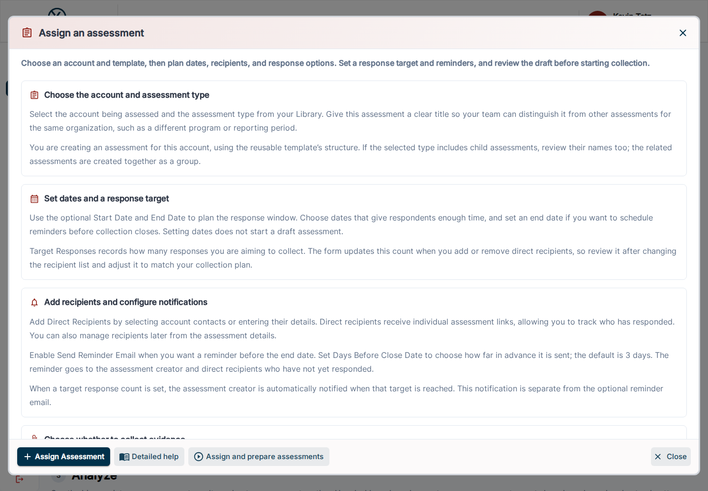

---
tags:
  - getting-started
---

# Assign an assessment

Choose an account and template, then plan dates, recipients, and response options. Set a response target and reminders, and review the draft before starting collection.

Open **Getting Started** in the application and select this card to read its guide. Use the action button to continue to the relevant workspace. Available actions depend on your role and enabled features.

## Choose the account and assessment type

Select the account being assessed and the assessment type from your Library. Give this assessment a clear title so your team can distinguish it from other assessments for the same organization, such as a different program or reporting period.

You are creating an assessment for this account, using the reusable template’s structure. If the selected type includes child assessments, review their names too; the related assessments are created together as a group.

## Set dates and a response target

Use the optional Start Date and End Date to plan the response window. Choose dates that give respondents enough time, and set an end date if you want to schedule reminders before collection closes. Setting dates does not start a draft assessment.

Target Responses records how many responses you are aiming to collect. The form updates this count when you add or remove direct recipients, so review it after changing the recipient list and adjust it to match your collection plan.

## Add recipients and configure notifications

Add Direct Recipients by selecting account contacts or entering their details. Direct recipients receive individual assessment links, allowing you to track who has responded. You can also manage recipients later from the assessment details.

Enable Send Reminder Email when you want a reminder before the end date. Set Days Before Close Date to choose how far in advance it is sent; the default is 3 days. The reminder goes to the assessment creator and direct recipients who have not yet responded.

When a target response count is set, the assessment creator is automatically notified when that target is reached. This notification is separate from the optional reminder email.

## Choose whether to collect evidence

This option appears when the feature is enabled for your organization.

Allow evidence uploads lets respondents attach supporting evidence to individual questions, giving your team more context when reviewing responses.

This option starts with the selected assessment type’s default. You can turn it on or off for this assessment without changing the reusable template. Decide whether supporting evidence will be useful before inviting respondents.

## Save and review before starting

Review the account, template, names, dates, recipients, and settings, then save. The assessment is created in Draft status and its details page opens, with the Assessment Workflow Guide showing your next steps.

Make any final changes, then follow the Start guidance in Deliver to respondents to move the assessment to In Progress before collecting responses. Your Library template remains available for future assessments.

## Continue

[Deliver to respondents](step-3-deliver.md) · [Assessment setup reference](../../assessments/create.md)
