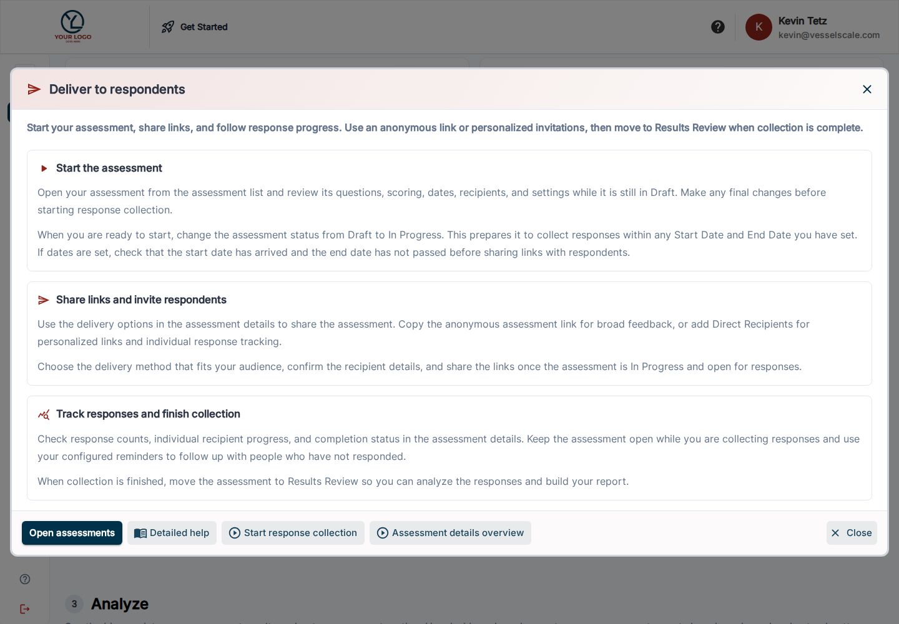

---
tags:
  - getting-started
---

# Deliver to respondents

Start your assessment, share links, and follow response progress. Use an anonymous link or personalized invitations, then move to Results Review when collection is complete.

Open **Getting Started** in the application and select this card to read its guide. Use the action button to continue to the relevant workspace. Available actions depend on your role and enabled features.

## Start the assessment

Open your assessment from the assessment list and review its questions, scoring, dates, recipients, and settings while it is still in Draft. Make any final changes before starting response collection.

When you are ready to start, change the assessment status from Draft to In Progress. This prepares it to collect responses within any Start Date and End Date you have set. If dates are set, check that the start date has arrived and the end date has not passed before sharing links with respondents.

## Share links and invite respondents

Use the delivery options in the assessment details to share the assessment. Copy the anonymous assessment link for broad feedback, or add Direct Recipients for personalized links and individual response tracking.

Choose the delivery method that fits your audience, confirm the recipient details, and share the links once the assessment is In Progress and open for responses.

## Track responses and finish collection

Check response counts, individual recipient progress, and completion status in the assessment details. Keep the assessment open while you are collecting responses and use your configured reminders to follow up with people who have not responded.

When collection is finished, move the assessment to Results Review so you can analyze the responses and build your report.

## Continue

[Build your report](step-4-build-report.md) · [Assessment details](../../assessments/details.md)
