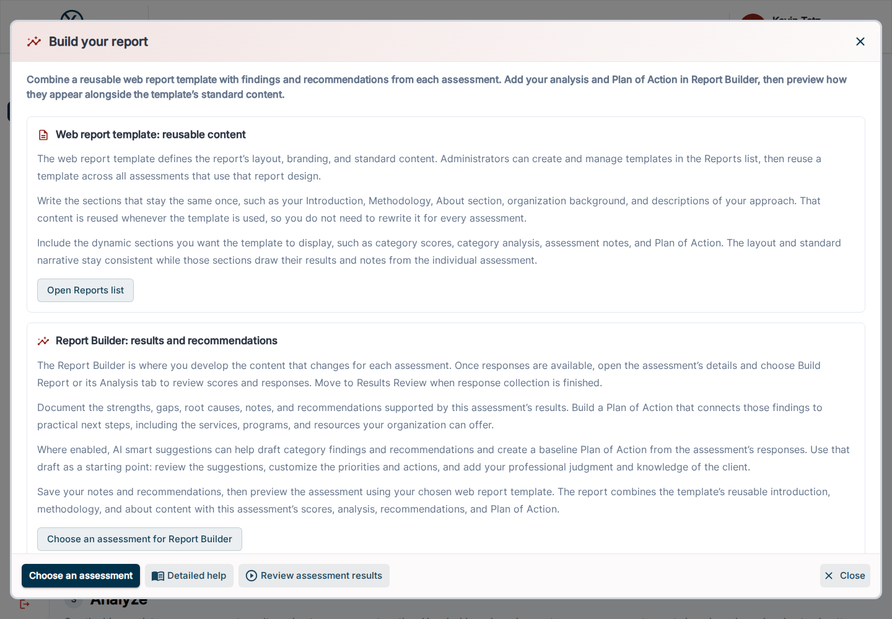

---
tags:
  - getting-started
---

# Build your report

Combine a reusable web report template with findings and recommendations from each assessment. Add your analysis and Plan of Action in Report Builder, then preview how they appear alongside the template’s standard content.

Open **Getting Started** in the application and select this card to read its guide. Use the action button to continue to the relevant workspace. Available actions depend on your role and enabled features.

## Web report template: reusable content

The web report template defines the report’s layout, branding, and standard content. Administrators can create and manage templates in the Reports list, then reuse a template across all assessments that use that report design.

Write the sections that stay the same once, such as your Introduction, Methodology, About section, organization background, and descriptions of your approach. That content is reused whenever the template is used, so you do not need to rewrite it for every assessment.

Include the dynamic sections you want the template to display, such as category scores, category analysis, assessment notes, and Plan of Action. The layout and standard narrative stay consistent while those sections draw their results and notes from the individual assessment.

## Report Builder: results and recommendations

The Report Builder is where you develop the content that changes for each assessment. Once responses are available, open the assessment’s details and choose Build Report or its Analysis tab to review scores and responses. Move to Results Review when response collection is finished.

Document the strengths, gaps, root causes, notes, and recommendations supported by this assessment’s results. Build a Plan of Action that connects those findings to practical next steps, including the services, programs, and resources your organization can offer.

Where enabled, AI smart suggestions can help draft category findings and recommendations and create a baseline Plan of Action from the assessment’s responses. Use that draft as a starting point: review the suggestions, customize the priorities and actions, and add your professional judgment and knowledge of the client.

Save your notes and recommendations, then preview the assessment using your chosen web report template. The report combines the template’s reusable introduction, methodology, and about content with this assessment’s scores, analysis, recommendations, and Plan of Action.

## Continue

[Share the results](step-5-provide-results.md) · [Report Builder reference](../../assessments/report-builder.md) · [Reusable report templates](../../settings/web-reports.md)
