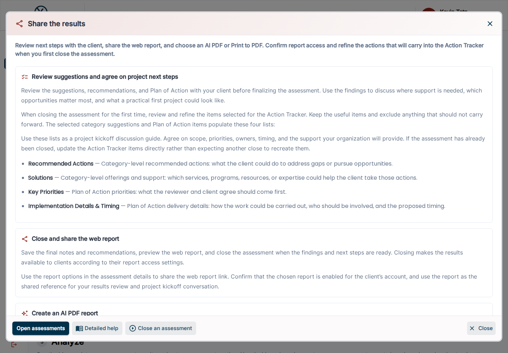

---
tags:
  - getting-started
---

# Share the results

Review next steps with the client, share the web report, and choose an AI PDF or Print to PDF. Confirm report access and refine the actions that will carry into the Action Tracker when you first close the assessment.

Open **Getting Started** in the application and select this card to read its guide. Use the action button to continue to the relevant workspace. Available actions depend on your role and enabled features.

## Review suggestions and agree on project next steps

Review the suggestions, recommendations, and Plan of Action with your client before finalizing the assessment. Use the findings to discuss where support is needed, which opportunities matter most, and what a practical first project could look like.

When closing the assessment for the first time, review and refine the items selected for the Action Tracker. Keep the useful items and exclude anything that should not carry forward. The selected category suggestions and Plan of Action items populate these four lists:

Use these lists as a project kickoff discussion guide. Agree on scope, priorities, owners, timing, and the support your organization will provide. If the assessment has already been closed, update the Action Tracker items directly rather than expecting another close to recreate them.

- **Recommended Actions** — Category-level recommended actions: what the client could do to address gaps or pursue opportunities.
- **Solutions** — Category-level offerings and support: which services, programs, resources, or expertise could help the client take those actions.
- **Key Priorities** — Plan of Action priorities: what the reviewer and client agree should come first.
- **Implementation Details & Timing** — Plan of Action delivery details: how the work could be carried out, who should be involved, and the proposed timing.

## Close and share the web report

Save the final notes and recommendations, preview the web report, and close the assessment when the findings and next steps are ready. Closing makes the results available to clients according to their report access settings.

Use the report options in the assessment details to share the web report link. Confirm that the chosen report is enabled for the client’s account, and use the report as the shared reference for your results review and project kickoff conversation.

## Create an AI PDF report

Where AI PDF is enabled for a web report, use its AI PDF option in the report options or the PDF button on the web report to generate a downloadable document from the report content. Generation can take a little time; review the finished PDF before downloading and sharing it.

Choose AI PDF when you want a generated PDF version of the report for sharing or offline review. This is a separate generation step from printing the web page.

## Print the web report to PDF

For a browser-produced PDF of the web report, use Print on the report when available, or open your browser’s Print command and select Save as PDF. Check the print preview, page size, and margins before saving.

Print to PDF uses the web report’s print layout and does not run AI PDF generation. Use it when you want to save or print the report directly from your browser.

## Continue

[Track and measure impact](../../impact-tracker/index.md) · [PDF reports](../../assessments/pdf-reports.md) · [Explore your dashboard](../../dashboard/index.md)
