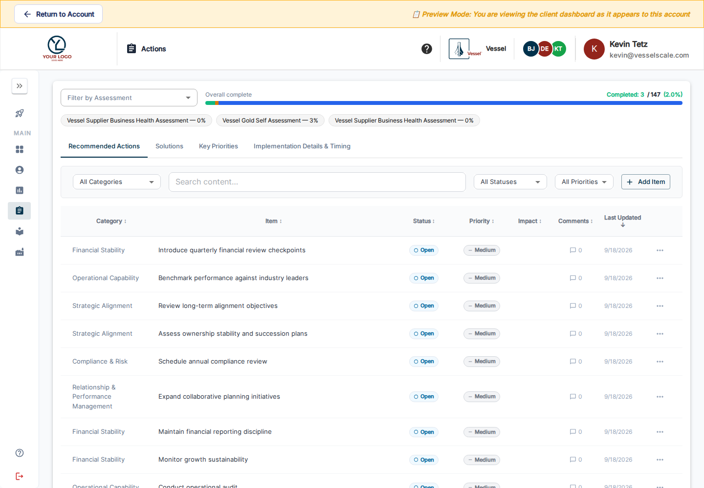

---
tags:
  - impact-tracker
---

# Action Tracker

Manage the work behind your recommendations, record impact metrics, and explore the results in dashboards and on the map. Keep priorities, due dates, and progress current in the Action Tracker, and update business outcomes as clients confirm results.

## Keep the connection from findings to action

The Action Tracker is initially populated from the suggestions and Plan of Action items reviewed when an assessment is closed for the first time. Selected category recommendations become Recommended Actions and Solutions; the assessment’s Plan of Action supplies Key Priorities and Implementation Details & Timing.

Those items retain their account, assessment, and category context, so you can trace follow-up work back to the organization and findings that prompted it. Category-based items remain associated with their category; priorities and implementation details are assessment-level Global Items.

After that initial handoff, manage and refine the items directly in the tracker. Reclosing an assessment does not recreate or automatically refresh its existing action items.

## Manage existing items and add new work

Open the Actions area for an account or a closed assessment, or work with the client through their portal’s Actions area. Select an assessment and switch between the four lists to review the relevant work; use category, status, priority, and search controls to focus the list.

Use Add Item to record additional recommendations, opportunities, or project steps as they arise. Select the relevant assessment and, for category-based lists, the appropriate category so manually added work stays connected to the same account and assessment context.

Edit the item text, update its status and priority, set a due date, and use comments to record discussions and progress. Add a project link when the work is tracked in another system. Keep items current as work moves through Open, In Progress, On Hold, and Completed, or mark items Not Applicable or Won’t Do when appropriate.

## Aggregate the impact for dashboard analysis

The item-level metrics roll up across accounts and assessments in the Directors Dashboard’s impact component. This connects individual improvement projects to a higher-level picture of the value your program is delivering.

Choose the metric, status, priority, and aggregation you want to analyze. Use Sum for additive totals and Mean or Max for comparisons where appropriate, then explore bar, line, area, or donut views. Use the dashboard’s analytics and export tools to examine the underlying data and prepare program or leadership reporting.

Keep the item records and measurement basis up to date: dashboard totals and comparisons depend on the metrics and filters you have chosen.

## See where the impact is happening

In Ecosystem, switch to Impact to put the same recorded action-tracker metrics on the map for accounts with mapped locations. Select a metric and Sum, Mean, or Max, then filter by status, priority, geography, industry, or account characteristics.

Use the map to see where savings, revenue opportunities, jobs, time savings, and other outcomes are concentrated. Select an account to inspect its Impact items and the assessments behind them, connecting regional patterns back to the work with each client.

List names can follow your organization’s terminology.

[Impact metrics](metrics.md) · [Collaboration](collaboration.md) · [Share the results](../getting-started/workflow/step-5-provide-results.md)
