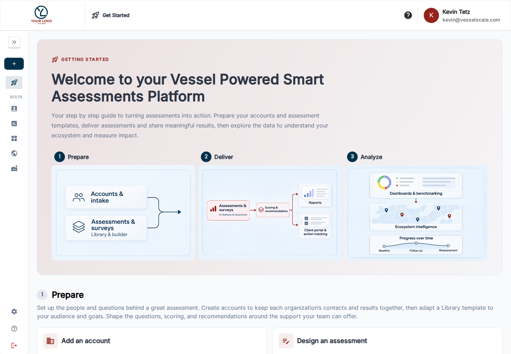

---
tags:
  - index.md
---

# Vessel Smart Assessment Platform Help Center

Turn assessments into useful client results and measurable outcomes. Start with the **Getting Started** landing page in the application, then use these guides for the task you are working on.

[Getting Started](getting-started/index.md){ .md-button .md-button--primary }
[Client Getting Started](client-portal/getting-started.md){ .md-button }

## Prepare → Deliver → Analyze

1. **Prepare** — [Add an account](getting-started/before-you-begin/add-account.md) and [adapt an assessment template](getting-started/before-you-begin/design-assessment.md) from the Shared Template Library.
2. **Deliver** — [Assign](getting-started/workflow/step-1-assign.md), [deliver to respondents](getting-started/workflow/step-3-deliver.md), [build your report](getting-started/workflow/step-4-build-report.md), and [share the results](getting-started/workflow/step-5-provide-results.md).
3. **Analyze** — Explore [dashboards](dashboard/index.md), the [Client Portal](client-portal/index.md), your [ecosystem](ecosystem/index.md), and [action outcomes](impact-tracker/index.md).

## Help by workspace

| Workspace | Guides |
| --- | --- |
| Accounts | [Account list](accounts/index.md), [create](accounts/create.md), [edit](accounts/edit.md), [details and report access](accounts/details.md), [import/export](accounts/import-export.md), [intake forms](settings/intake-forms.md) |
| Assessments | [Collections](assessments/index.md), [assign](assessments/create.md), [responses and analysis](assessments/details.md), [Report Builder](assessments/report-builder.md), [PDF output](assessments/pdf-reports.md) |
| Assessments → Library | [Template list](library/list.md), [create](library/create.md), [edit and preview](library/edit.md), [conditional logic](library/conditional-logic.md), [question types](library/question-types.md), [scoring](library/scoring.md), [icons](library/editing-icons.md) |
| Assessments → Reports | [Reusable web reports](settings/web-reports.md), [PDF settings](settings/pdf-reports.md) |
| Client Portal | [Getting Started](client-portal/getting-started.md), [account and navigation](client-portal/index.md), [assessments](client-portal/assessments-table.md), [Library](client-portal/library.md), [benchmarking](client-portal/industry-benchmarking.md), [staff preview guide](client-portal/ae-notes.md) |
| Dashboard | [Overview](dashboard/index.md), [components](dashboard/components.md), [configure](dashboard/configure.md), [Directors](dashboard/directors-dashboard.md), [exports](dashboard/download.md), [pivot tables](dashboard/pivot-table.md) |
| Ecosystem | [Map](ecosystem/index.md), [filters](ecosystem/filters.md), [scores](ecosystem/scores.md), [accounts](ecosystem/accounts.md), [legislators](ecosystem/legislators.md) |
| Action Tracker | [Manage work](impact-tracker/index.md), [comments](impact-tracker/collaboration.md), [impact metrics](impact-tracker/metrics.md) |
| Industries | [Industry explorer](industries/index.md), [NAICS hierarchy](industries/hierarchy.md), [use across the platform](industries/platform-integration.md) |
| Settings | [Overview](settings/index.md), [branding](settings/branding.md), [users](settings/users.md), [roles](settings/permissions.md), [email](settings/email-templates.md), [custom data](settings/custom-data/index.md), [profile](settings/user-profile.md) |

Available tools and labels vary with your role, enabled features, and organization’s terminology. For common questions, visit [FAQ](faq.md). Contact [support@vesselscale.com](mailto:support@vesselscale.com) for help.
