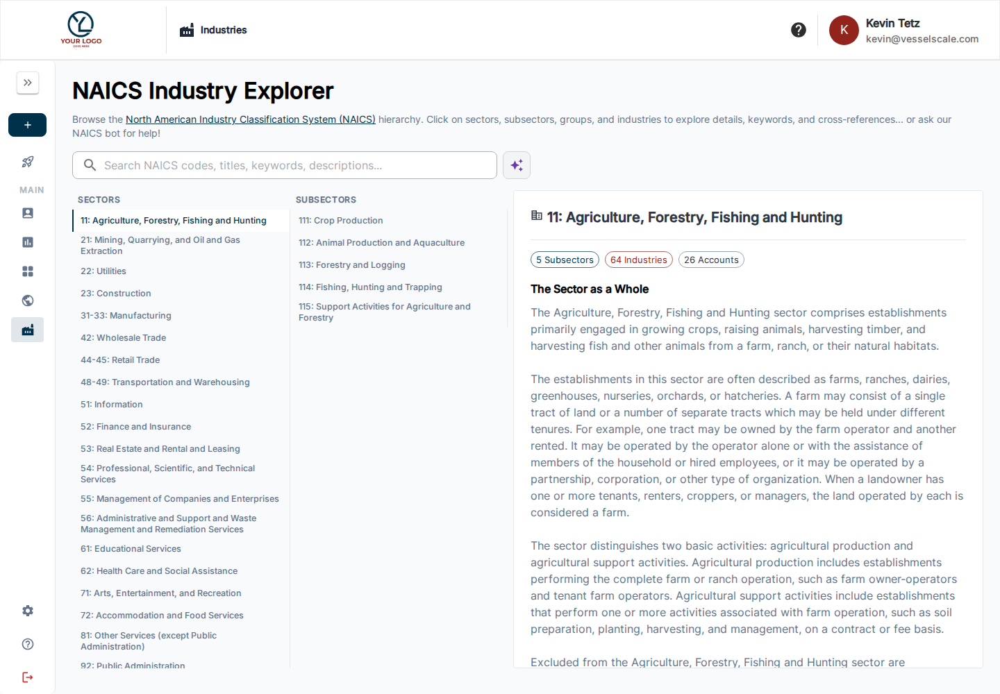

# Industries

Open **Industries** from staff navigation. The client portal has its own Industries view, which offers industry context without exposing other organizations’ staff account summaries. Use [Client industry context](../client-portal/industry-benchmarking.md) for that workflow.

The Industries page (NAICS Explorer) is a full reference for the North American Industry Classification System (NAICS) — the standard used to classify businesses by industry across the United States, Canada, and Mexico.

## What you can do here

- Browse the full NAICS hierarchy from broad Sectors down to specific 6-digit Industry codes
- Click any code to see its description, sub-codes, and related accounts in your ecosystem
- Search for codes by keyword or describe a business in plain language and let the AI suggest the right classification
- Understand how NAICS codes assigned to Accounts power dashboards, reports, and map filters

## Overview

The Industries explorer is organized as a four-column hierarchy — Sector, Subsector, Group, and Industry. Selecting any item in one column narrows the options in the next, letting you drill down from a broad economic category to a precise 6-digit code.

## In this section

- [NAICS Hierarchy](hierarchy.md) — browse the four levels (Sector → Subsector → Group → Industry) and use search
- [Platform Integration](platform-integration.md) — how NAICS codes flow through dashboards, reports, the map, and intake forms
