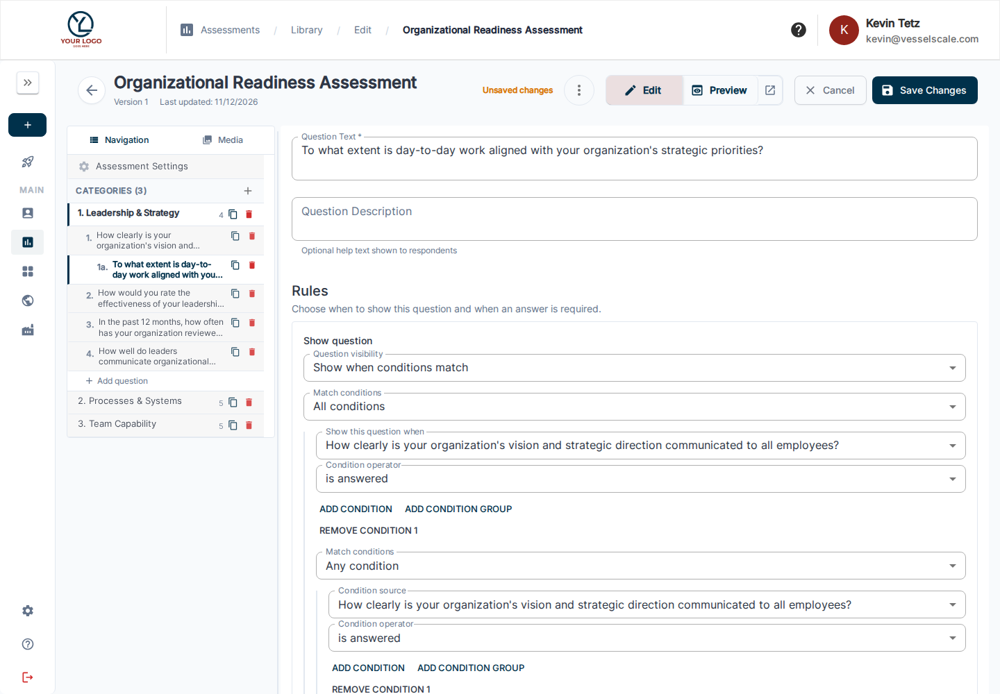
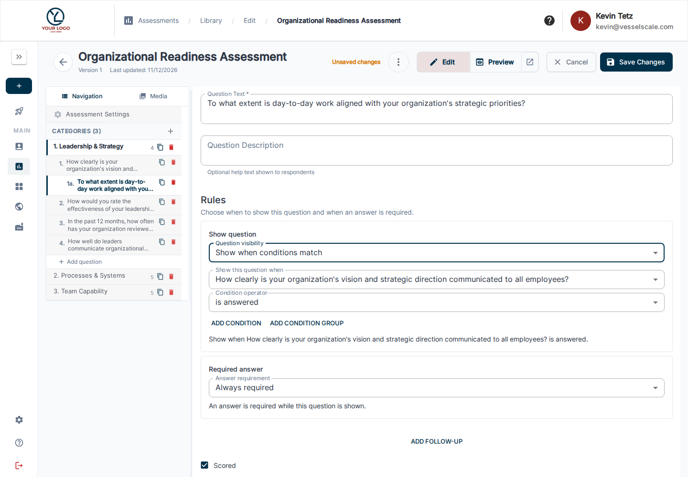
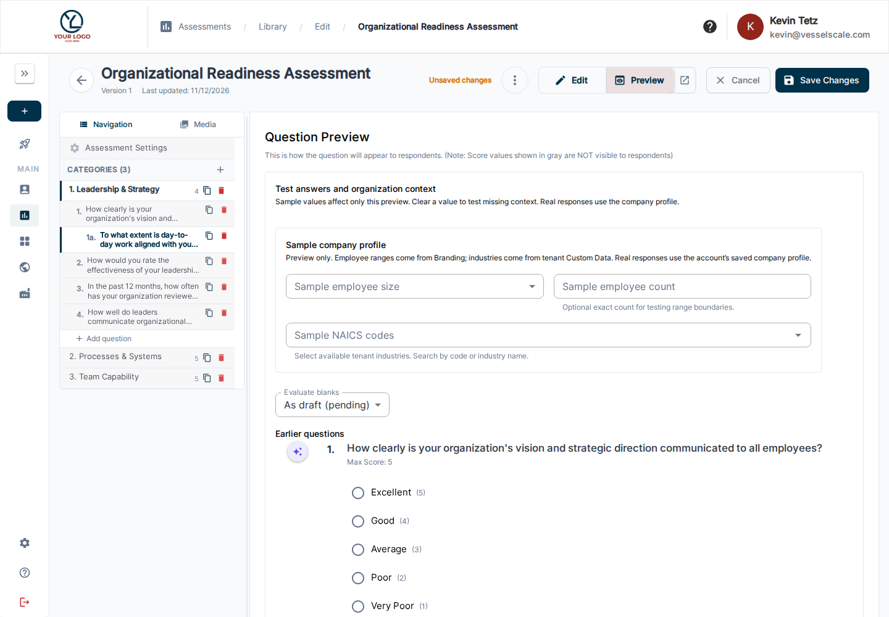

# Conditional Logic

Conditional logic lets an assessment show relevant questions, hide questions that do not apply, and ask for an answer only when a rule is met. Rules are configured in the Library assessment editor and run in the respondent's normal question and category order.

## What you can do

| Rule | Result |
| --- | --- |
| Show a question when conditions match | The question appears only when its rule matches. Hidden questions do not require an answer. |
| Show a category when conditions match | The category and its applicable questions appear only when its rule matches. |
| Require an answer when conditions match | The question can remain visible for everyone, but an answer is required only on matching paths. |
| Combine several checks | Use **All** when every check must match, **Any** when one or more checks may match, or nest groups to express a more specific rule. |

For example, a LOW rating can show a required text follow-up. Or the follow-up can stay visible to everyone and become required only for LOW. These are different behaviors: the first controls visibility; the second controls whether an answer is required.

Rules can check an earlier question's answer or company information: employee size, exact employee count, and NAICS industries. Questions and categories remain in their authored order; conditional logic does not jump to a chosen question or end an assessment early.

## What condition groups mean

- **All** means every condition in the group must match (AND). Example: show a follow-up when the rating is LOW **and** the process is undocumented.
- **Any** means at least one condition in the group must match (OR). Example: show it when the rating is LOW **or** the process is undocumented.
- **Nested groups** combine both meanings. Example: show a section when the rating is LOW **and** (**either** the process is undocumented **or** an owner is missing).

Each group supports up to 20 conditions or subgroups, with nesting limited to eight levels.

A category is a group of questions. A condition group is a group of checks that decides whether a rule applies. If both a category and one of its questions have visibility rules, both rules must match for that question to appear.

## Configure a rule

1. Open a draft template from **Assessments → Library** and select **Edit**. Conditional rules are changed in a draft, not in the text-only published editor.
2. In **Assessment Settings**, turn on **Enable Conditional Logic**. This reveals the rules controls, follow-up helper, and conditional preview controls.
3. Add or select the question to control. For a question rule, open that question's **Rules** section. For a category rule, open the category and use **Section rules**.
4. Choose whether the question or category is always shown or shown only when conditions match. For questions, also choose whether an answer is optional, always required, or required when conditions match.
5. Add one or more conditions. Select an earlier question or an organization field, choose a comparison, then select or enter the value. Use **Add condition** and **Add condition group** to build All/Any logic. Remove or edit individual conditions in the same form.
6. Save the draft and use Preview to check both matching and nonmatching answers before publishing.

Source questions must come before the question they control. A category can use questions from earlier categories. If a source question is moved or deleted, review rules that refer to it.

### Available sources and comparisons

| Source | Comparisons |
| --- | --- |
| Single-choice answers and presets | equals; is any of; is none of; is answered |
| Multiple-select answers | equals (contains that answer); is any of; is none of; is answered |
| Numeric and numeric-range answers | equals; greater than; at least; less than; at most; is answered |
| Open-text answers | text equals; text contains; starts with; is answered |
| Organization employee size | equals; is any of; is none of; is answered |
| Organization employee count | equals; greater than; at least; less than; at most; is answered |
| Organization NAICS industries | equals; is any of; is none of; starts with an industry group; is answered |
| Question answer status | is answered; is not answered |

The editor offers only comparisons that fit the selected source. Choice and NAICS values are selected from available options; NAICS rules use the configured industry choices rather than requiring a respondent or author to invent a code.

Text comparisons ignore letter case and trim spaces at the beginning and end. They are exact for internal spacing and other characters. For multiple-choice and NAICS answers, **equals** means the selected value is present; it does not require the entire multi-select response to contain only that value.

## Use organization information

- **Employee size** uses the Small and Medium upper bounds configured in **Settings → Branding**. Small includes the Small upper bound; Medium is above Small through the Medium upper bound; Large is above Medium. Use **Organization employee count** when the rule should use an exact numeric comparison instead.
- **Employee count** uses the saved count on the respondent's company profile. If the value is missing, the rule cannot be evaluated.
- **NAICS industries** uses the active industry definitions and the company's saved NAICS selections. In Preview, select one or more sample industries from the searchable dropdown. Missing or unavailable organization information does not satisfy a rule.

Changing Branding thresholds or a company's profile can affect an assessment that is still in progress. Completed responses keep their recorded results.

## Preview and verify

Use the **Preview** controls inside the Library editor to try sample answers and organization details. Public preview links do not provide the same conditional testing controls.

For every rule, try at least one matching and one nonmatching path. For nested groups, try combinations that change the result. Check that the right questions and categories appear and that visible questions have the expected required status. For employee size, test the configured boundaries; for NAICS, test both a matching industry and a different industry. Preview is a draft check and does not replace testing a real respondent submission.

Before publishing, review the complete respondent flow. Confirm the source question appears first, hidden follow-ups are not required, and conditional requirements behave as intended. After publishing, create a test assessment and verify submission, scoring, and report behavior in your normal QA process.

## Current limits

Conditional logic currently supports question and category visibility, conditional question requirements, earlier-question answers, employee-size and employee-count context, NAICS context, and nested All/Any groups. It does not currently support calculated score conditions, a visual map of every branch, explicit jump-to-question or early-finish actions, standalone NOT/XOR groups, custom scripts, or random branching.

The category preview may still show a category tab when all of its questions are hidden. Verify category navigation in a test respondent assessment as well. Preview does not prove that real submission, scoring, or reporting has been tested.

[Edit an assessment template](edit.md) · [Question types](question-types.md) · [Scoring](scoring.md)
