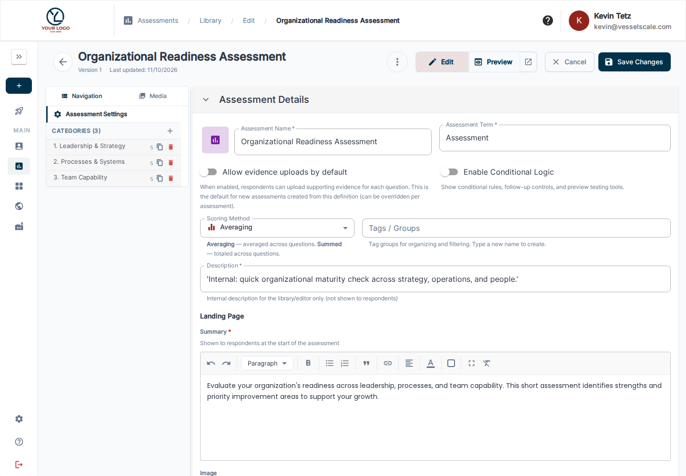
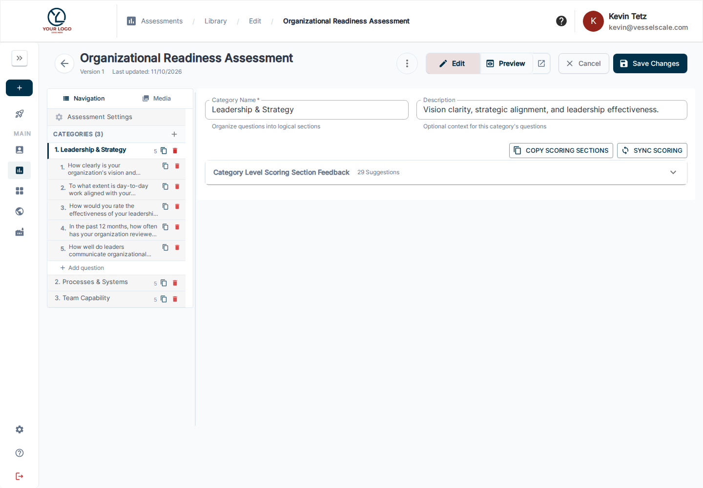
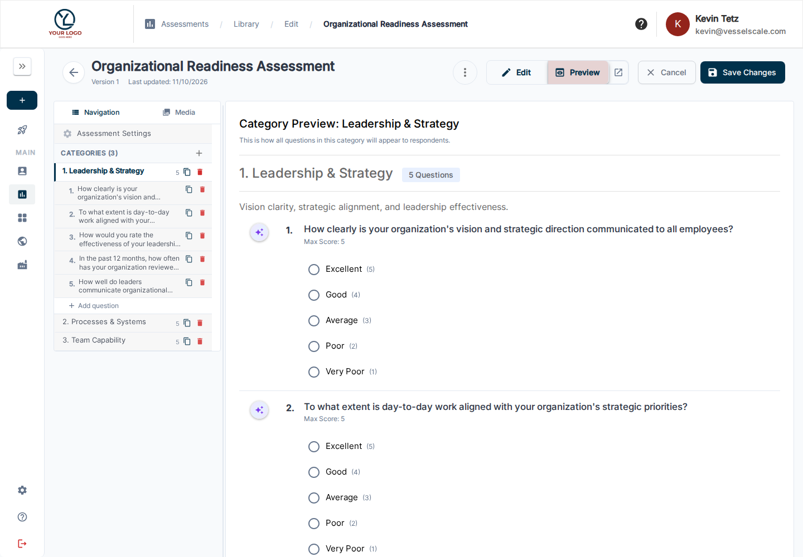
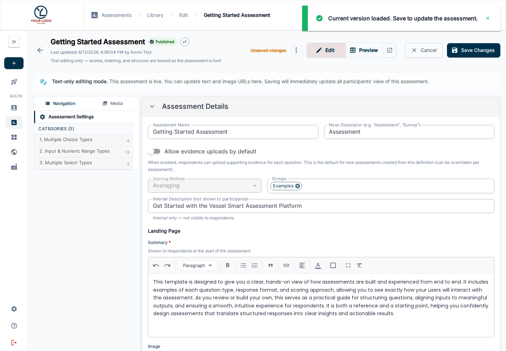

# Edit an Assessment Template

Open **Assessments → Library** and select the appropriate editing action for your template. The unified workspace puts navigation and media in a resizable sidebar with **Edit** and **Preview** controls above the working area.

## Navigate and save

Use **Navigation → Assessment Settings** for template-level configuration. Select a category or question in the sidebar to work on it. Expand categories to see their questions. Use **Media** to find supporting images without leaving the editor. Resize the sidebar to suit your working area.

Use **Save Changes** and check the save status or confirmation before leaving. **Cancel** exits the editing flow; save the changes you intend to keep first. Available editing actions depend on the template’s status and your permissions.

## Assessment settings

- **Assessment Name** identifies the reusable template. **Assessment Term** controls its terminology.
- **Description** is for the Library/editor; **Landing Page → Summary** is the respondent-facing introduction.
- **Tags / Groups** organizes the template for browsing and filtering.
- **Scoring Method** chooses averaging or summing. Configure category and overall feedback to suit that method.
- **Allow evidence uploads by default**, where available, provides the starting setting for new assessments. It can be overridden per assigned assessment.
- **Enable Conditional Logic** reveals optional conditional rules, follow-up authoring, and preview tools.

## Landing and completion pages

Write a clear landing summary covering purpose, audience, and instructions. Optional images can be selected from the Media Library or supplied as URLs. Check that each image loads and use the available placement controls to fit the page.

Configure the completion heading, summary, and optional image to explain what happens after submission. Avoid promising a report delivery time your team has not arranged.

## Categories and questions

Organize questions into categories, then use the navigation controls to select, add, copy, reorder, or remove content as appropriate for a draft. Choose response types, answer options, numeric units or ranges, and point values. Check the [question type reference](question-types.md) and [scoring guide](scoring.md).

Conditional authoring is optional. Enable it when needed, configure follow-up questions, required explanations, or section visibility rules, and test both triggering and non-triggering answers in Preview. Review the complete respondent path before publishing.

## Scoring and feedback

Configure score ranges and category feedback: strengths, gaps, root causes, solutions, and recommended actions as supported by the template. Connect the recommendations with the support your team can provide.

Use **Sync Scoring** when the scoring content needs to be brought into alignment after question or score changes. Review the result before saving. Where **Copy Scoring Sections** is offered, use it to reuse a feedback structure, then check the receiving category’s ranges and recommendations.

## Preview and find/replace

Use **Preview** for the respondent experience, including category/question previews and conditional testing where available. The popout preview opens a separate viewing area. Preview mode does not save your changes.

Use **More Actions → Find and Replace** when available to update repeated text. Check the replacements across settings, questions, and feedback, then save. Preview again after bulk changes.

## Published templates

If **Resolve Assessment Text Differences** appears, compare the Live and Library text and choose the versions to use, then open the editor with those selections. Review the final content before saving.

The published editor is **text-only**: scores, ordering, and structure are locked because the assessment is live. It allows supported text and image updates; saving can immediately affect participants’ views. For structural or scoring changes, use a draft version and the publishing workflow.

[Library](index.md) · [Create a template](create.md) · [Scoring](scoring.md) · [Editing icons](editing-icons.md)
