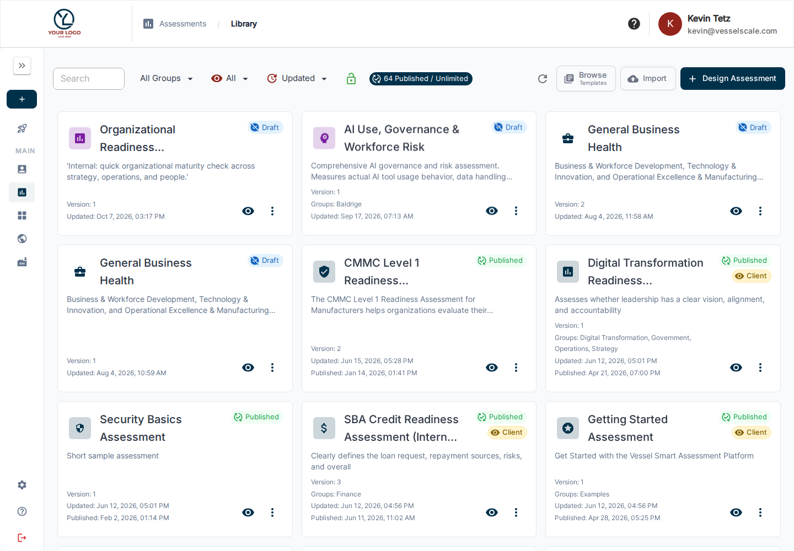

# Assessment Library

Open **Assessments → Library** to manage reusable assessment templates. Your templates provide the questions, categories, scoring rules, and feedback used when assigning an assessment to an account.

## Start from shared content

Choose **Browse** to explore the **Shared Template Library**. Preview the available Vessel templates and copy a useful starting point into your own Library as a draft. Customize that copy for your audience and your organization’s services before publishing it.

Use **Design Assessment** to build your own template, or **Import** for supported YAML input. Where enabled, AI Creator can help draft content; review questions, scoring, and recommendations before client use.

## Manage the lifecycle

Edit drafts freely and preview the respondent experience before publishing. Published text can be updated through the text-only editor, while scores, ordering, and structure are locked. Use the appropriate draft/version workflow for structural changes. Publishing a template makes it reusable; it does not start a client’s response collection.

The **Client** visibility control determines whether an eligible published top-level template appears in the client Library. The staff Library, Shared Template Library, and client Library are separate catalogs.

[Template list](list.md) · [Create](create.md) · [Edit and preview](edit.md) · [Question types](question-types.md) · [Scoring](scoring.md) · [Icons](editing-icons.md)
