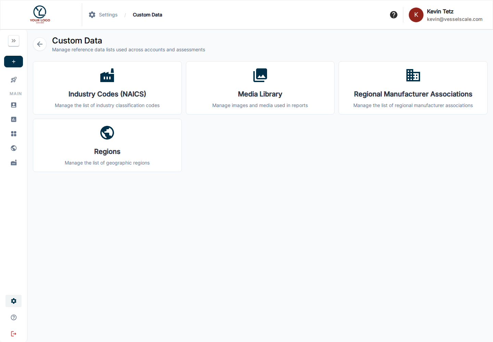

# Custom Data

Open **Settings → Custom Data** to manage the reference data and media available to your organization.

- [NAICS Codes](naics.md) — industry classifications used in account profiles, intake, filters, and comparisons.
- [Regional Manufacturer Associations](rma.md) — regional association reference records.
- [Regions](regions.md) — geographic groupings used in organization data and analysis.
- [Media Library](media-library.md) — reusable images and media for templates, intake forms, reports, and branding.

Reference data changes can affect which choices users see when setting up accounts or filtering results. Review active/inactive controls and saved values in the relevant list before editing shared records.

[Settings](../index.md) · [Account profiles](../../accounts/details.md) · [Industries](../../industries/index.md) · [Dashboard exports](../../dashboard/download.md)
