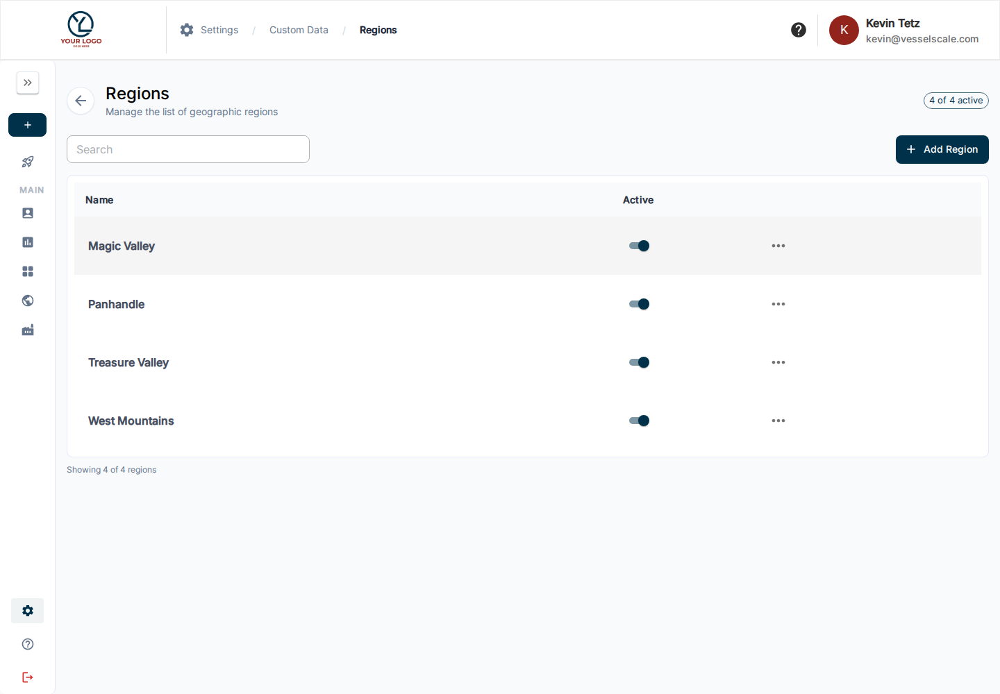

# Regions

Open **Settings → Custom Data → Regions** to manage the organization’s regional reference records. Regions provide a consistent way to group accounts for filtering, exports, and analysis.

Search the available records and use the add/edit and active-status controls offered by the list. Review existing names before adding a region so account profiles use consistent values. Save the intended changes and verify the record in the list.

Choose the appropriate region in an account’s profile. Additional region-related account columns can be selected explicitly in dashboard exports and pivot analysis.

[Custom Data](index.md) · [Edit an account](../../accounts/edit.md) · [Dashboard exports](../../dashboard/download.md)
