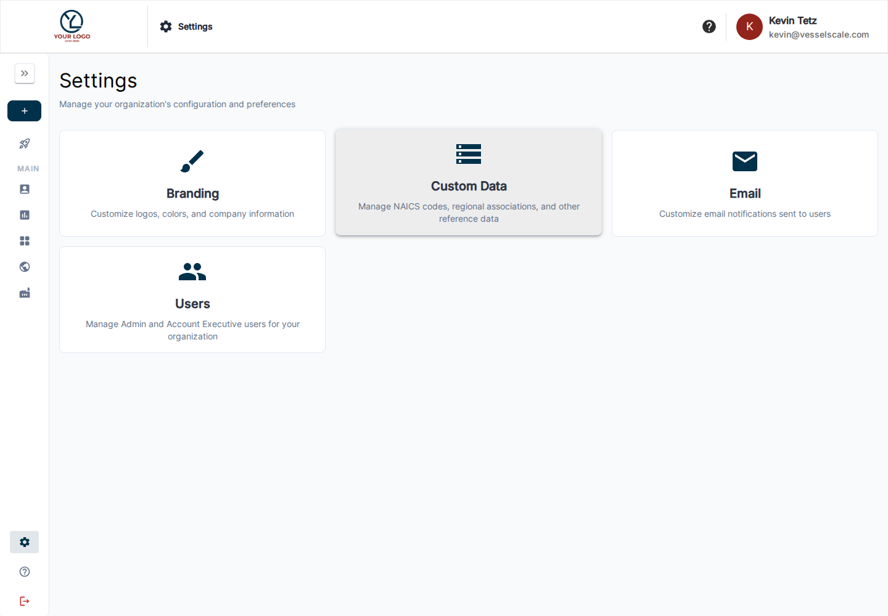

# Settings

Administrators use **Settings** to manage the organization configuration available to them. The page’s tools depend on enabled features and permissions.

## Organization settings

- [Branding](branding.md) — logos, colors, navigation appearance, and terminology.
- [Custom Data](custom-data/index.md) — NAICS, regional associations, regions, and media.
- [Email Templates](email-templates.md) — outgoing platform messages and variables.
- [Manage Users](users.md) — staff users and available role controls.
- [Permissions](permissions.md) — staff/client scope and privacy.

## Related configuration workspaces

**Accounts → Intake Forms** manages public account onboarding. **Assessments → Reports** manages reusable web report templates, including PDF settings. **Assessments → Library** manages assessment templates. These tools are grouped with the work they support.

[Intake forms](intake-forms.md) · [Web reports](web-reports.md) · [PDF output settings](pdf-reports.md) · [Your profile](user-profile.md)
