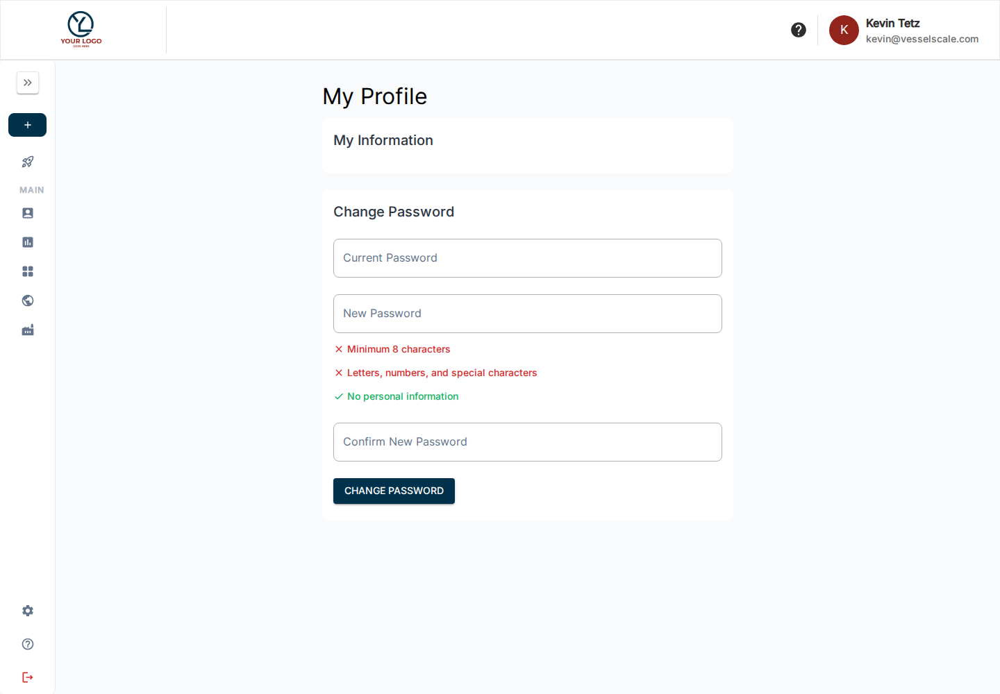

# Your Profile

Select your name/avatar in the header to open **My Profile** at `/profile`. This is your personal profile; the Account workspace holds organization information.

## My Information

Use the **My Information** section to review the personal fields and profile image available to you. Edit supported fields and save, then check the confirmation. Email changes or restricted fields may require help from your administrator.

## Change Password

In the **Change Password** section, enter your current password, enter and confirm the new password, then choose **Change Password**. Follow the displayed requirements: at least eight characters, a suitable mix of characters, and no personal information. Resolve any validation message before retrying.

If you forgot the current password, use the sign-in page’s password reset flow. Your organization’s sign-in method and policies can affect available profile/password controls.

[Client account information](../client-portal/index.md) · [Account details](../accounts/details.md) · [Permissions](permissions.md)
