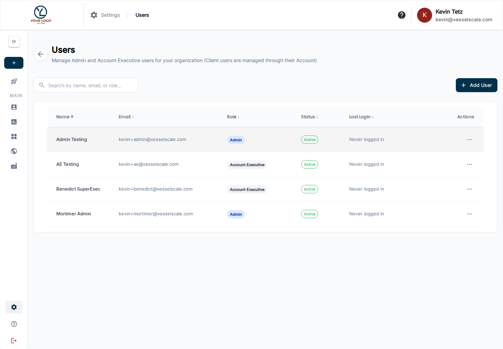

# Manage Users

Open **Settings → Users** to manage **Admin** and **Account Executive** users for your organization. **Client users are managed through their Account**, rather than this staff list.

## Find a staff user

Search or sort the list to inspect the user’s name, email, role, active status, and last login. Last login helps distinguish users who have accessed the platform from those who have never signed in.

## Add or edit a user

Choose **Add User**, enter the required first name and email, and select the appropriate staff role. Review active status and any optional contact fields offered by the form, then save. Use the existing row’s edit action to update supported details and role settings.

Review validation messages and confirm the saved user appears in the list. User-management actions follow your administrator permissions; role and active-status changes affect what the user can access.

## Manage account contacts and clients

Open the relevant **Account** to manage its contacts and client access. Maintain staff responsibilities through the account’s **Assignments** tab. A contact record, a portal login, and a staff assignment have distinct purposes; verify the intended access rather than assuming adding a contact completes every setup step.

[Permissions](permissions.md) · [Account contacts and assignments](../accounts/details.md) · [Settings](index.md)
