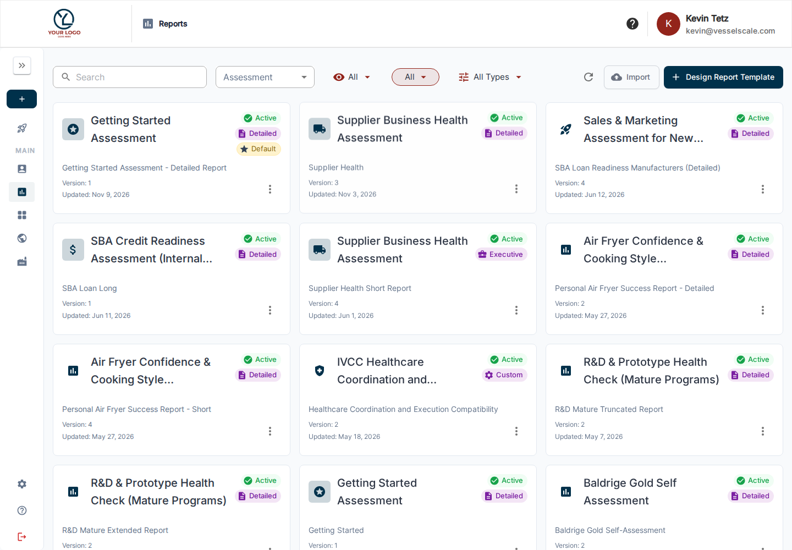
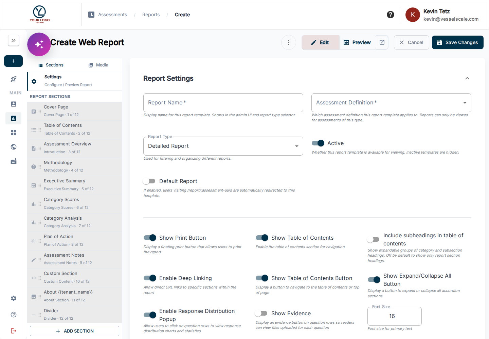
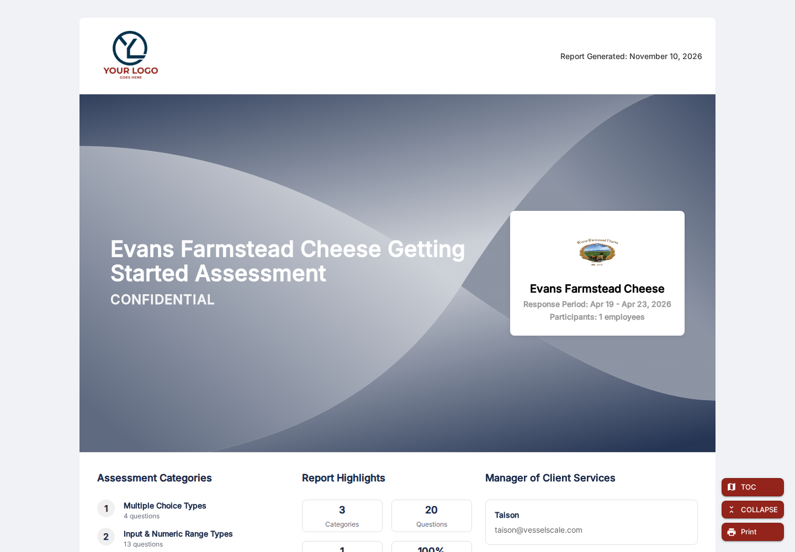

# Web Report Templates

Administrators manage reusable reports in **Assessments → Reports**. A template belongs to an assessment type and defines its layout, branding, standard narrative, and dynamic sections. Each assessment supplies its own results and saved analysis.

## Create or select a template

Search the list and filter by assessment type, active status, default status, or report type. Cards show the associated assessment type, template name, version, and update date. Choose **Design Report Template** to create a report or open an existing template. **Import** provides the supported YAML import choices.

Use the available card actions to edit, duplicate, export, or manage a template. Review the correct assessment type before changing shared content: a template can be reused by multiple assessments.

## Edit and preview workspace

The report editor combines a resizable navigation sidebar with the working area. Use **Edit** and **Preview** to switch views, inspect the full report or a selected section, and use popout preview when helpful. The sidebar also provides media access.

Select report settings or a section to edit it. Use the available section controls to add, remove, reorder, or configure content. Review the save state and use **Save Changes** to persist the intended template configuration. Check the current preview after saving.

## Report settings

| Setting | Purpose |
| --- | --- |
| Report Name | Internal name used in lists and report selectors. |
| Assessment Definition | The assessment type this report supports. |
| Report Type | Detailed Report, Executive Summary, or Custom Report. |
| Active | Makes the template available for use. |
| Default Report | Chooses the default report for this assessment type. |
| Show Print Button | Offers browser printing from the rendered report. |
| Show Table of Contents | Enables contents navigation. |
| Include subheadings in table of contents | Adds detailed entries when enabled; readers can expand or collapse them. |
| Enable Deep Linking | Supports links into report sections. |
| Show Table of Contents Button | Adds a navigation shortcut. |
| Show Expand/Collapse All Button | Offers bulk accordion controls. |
| Font and header styling | Sets text size and section/subsection appearance. |
| AI PDF | Explicitly enables generated PDF output and its density/detail options. |

Browser printing is the default PDF path. AI PDF is a separate opt-in; turning it on does not generate a document until generation is requested.

## Build reusable and dynamic sections

Use standard sections such as **Cover Page**, **Table of Contents**, **Introduction**, **Methodology**, **Executive Summary**, **Category Scores**, **Category Analysis**, **Plan of Action**, **Assessment Notes**, **Custom Content**, **About**, and **Divider**, as available in the section selector.

Write the standard introduction, methodology, background, and organization content once. Dynamic score, analysis, notes, and Plan of Action sections draw from the selected assessment. Select the categories and content that fit the report’s purpose rather than rewriting the template for each client.

Configure section titles, visibility, style, images, and supported content blocks. When adding an image, select it through Media or enter its URL, check that it loads, and enable the corresponding show-image/background control where required.

## Template variables and configuration

Open **Template Variables Reference** for the current supported placeholders. Common variables include `{{ assessment_name }}`, `{{ account_name }}`, `{{ closed_date }}`, `{{ total_respondents }}`, `{{ overall_score }}`, `{{ normalized_score }}`, `{{ tenant_name }}`, and `{{ logo_url }}`. Use exact supported names and inspect the rendered result.

Where offered, **Preview Config** shows generated YAML for review or export. Prefer the editor for routine changes. After importing YAML, review validation messages and preview the sections before saving the template for use.

## Preview a real assessment

Use a relevant assessment for preview and confirm account identity, start and closing dates, scores, analysis, and Plan of Action. Template preview content and a real assessment’s data can differ; verify the intended account-specific report before sharing.

## Enable and share the correct report

1. Ensure the template is **Active** and belongs to the intended assessment type.
2. Set a default when that report should be the type’s standard route target.
3. In **Account → Reports**, enable the appropriate report entry for the specific completed assessment. Repeated uses of a template can have separate entries.
4. Use the assessment’s report controls or **Share Report** to open or share the intended web report or available stored PDF.

A full web report link identifies the assessment and report template: `/report/{assessmentUuid}/{reportUuid}/{reportSlug}`. The shorter `/report/{assessmentUuid}` route selects the available default/fallback report for that assessment. Share the specific report when recipients need a particular design.

[Report Builder](../assessments/report-builder.md) · [PDF settings](pdf-reports.md) · [Account report access](../accounts/details.md#reports-and-client-access) · [Share the results](../getting-started/workflow/step-5-provide-results.md)
